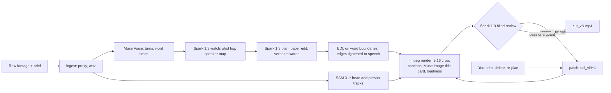

<p align="center">
  <picture>
    <source media="(prefers-color-scheme: dark)" srcset="assets/brand/svg/montivo-lockup-dark.svg">
    
  </picture>
</p>
<p align="center"><b>The video editor that watches its own cut.</b><br><code>plan → render → review → re-cut</code></p>

# Montivo

An agent-first video editor built on Meta's models. Give it spoken footage and a one-line brief: it picks the lines,
cuts on word boundaries, keeps the speaker in a 9:16 frame and captions it, then **watches its own render, turns
what is wrong into timed edits and renders again**, until the cut passes or a guard (budget, passes, a regression, a
repeated fix) stops the loop. Every version stays visible, and every edit, the agent's or yours, can be undone.

## See the correction

Run 015, Billy's own 69 s talking head (about $0.30 for the run and its review loop):

1. **Version 1 scored 68.** The blind reviewer, which gets the rendered video but never the plan, found the title card
   sitting on 1.5 s of silence and a caption that read "Soundtracks me so" where Billy says "SAM tracks me so" (Muse
   Voice had misheard it).
2. **The agent fixed both itself.** The two issues came back with a time in the cut and a fix op; the patcher dropped
   the card and retexted the line, rendered version 2 and reviewed it again: **81**.
3. **A person fixed the rest.** The reviewer still flagged two captions where Voice misheard Billy; he retyped those
   lines in the editor (four in all). Version 5 scores **87 with the measured checks clear**.

The Loop view shows exactly that: each version's frame and score, and between two versions what made the second one,
the reviewer's fix or a human edit, labelled. When a fix makes things worse the agent keeps the earlier cut: on a
hosted test upload the reviewer's own hook swap scored 48 against 74, and the regression guard kept the 74.

**Judges:** the hosted link and password are in the submission. Open a finished sample, press **Loop**, compare the
issue, the fix and the result, then make an edit of your own. Details under [Try it](#try-it).

## Built on Meta models

| Role | Model | What it does |
|---|---|---|
| Eyes and judgement | **Muse Spark 1.3** | shot log and speaker map (`watch`), paper edit by turn id with verbatim words (`plan`), the blind rubric review with fix ops (`review`), the Ask Montivo router |
| Open-weight planner | **Muse Spark Open** (on Baseten) | the paper edit (`plan`) when you pick it, in place of Spark 1.3: see [Open weight](#open-weight-muse-spark-open) |
| Ears and clock | **Muse Voice Transcribe 1.0** | turns, speakers and word timings of the footage, and each rendered cut transcribed again so the review can check its edge words |
| Camera operator | **SAM 3.1** | tracks the speaker's head (5 fps) for the 9:16 reframe and the person plus any callout concept per frame; the cutout on a cover |
| Art department | **Muse Image 1.0** | title card and B-roll stills |
| Hands | ffmpeg + Pillow | proxies, audio, trims, crop path, caption and callout overlays, the music bed and its ducking, loudness, H.264 |

Every runtime model is a Meta model. Every call's request and response JSON lands in the run folder next to a
ledger of tokens, dollars and seconds per stage.

## Evidence and limits

- **A development benchmark** (27/10): four fault types planted in three finished cuts, 28 blind reviews. 91 % of the
  planted faults were flagged as blocker or major; 2 of 22 faulty cuts still passed; 3 of 4 reviews of clean cuts
  passed. The checks and the planted faults were refined on these same cuts, so this is not a held-out error rate.
- **Unseen footage does not always pass.** Re-run on 28/10 with that day's code, a 4-astronaut NASA clip (66 at best:
  they talk over each other at every turn change), a USGS interview (68) and a multi-camera TEDx talk (70) improved or
  held but never passed. Montivo shows a bounded correction loop you can inspect; it does not promise a publishable
  cut on any footage.
- **The reviewer and the planner share a model family.** Withholding the plan removes one source of bias, not all of
  them; that is why measured checks (cut edges against the re-transcribed audio, the head inside the frame) can hold a
  pass the reviewer would give.

The full table is under [Measured results](#measured-results).

## Try it

**Judges:** Montivo runs hosted for you, with my Meta key on the server. The link and the password are in the
submission. Two finished projects open there, and you can upload your own clip (up to 90 s) and let the agent plan,
cut, review and re-cut it; your edits go to your own copy, so every judge starts from the same samples. A shared
budget caps the Meta model calls; past it, the finished projects and the $0 edits still work.

Locally, without an API key:

```bash
make dev    # Python 3.12 venv, needs ffmpeg and ffprobe on the PATH
make test   # the offline tests (recorded Voice and SAM streams, no network)
```

With a key (`MODEL_API_KEY`, dev.meta.ai), on your own footage:

```bash
make dev
export MODEL_API_KEY=...
.venv/bin/montivo run footage.mp4 --brief "A 40 second vertical reel: ..." --target 40 --review --out runs/001
make ui
```

## How the loop works

Montivo makes the correction loop visible: rendered video, timed issue, edit, new render. (Of the 16 AI video
editors whose public pages I read on 27/10, none described reviewing its own render; that is a reading of their
pages, not a test.) In detail:

- **A blind reviewer.** Spark 1.3 gets the rendered vertical cut (with a clock burned in, because it sees about one
  frame per second and no timestamps), the brief, a rubric and four measured facts: the silences in the cut, where
  every caption sits against the speaker's head box, the source audio level at both edges of every cut (a model
  does not hear a clipped syllable; the waveform does) and the caption timeline (a line up under a second can fall
  between the frames it sees). It never sees the plan or the edit list.
- **A pass the reviewer cannot give alone.** Muse Voice re-transcribes every cut and two measured checks run on it:
  a kept word at a cut edge that the cut no longer says, and the speaker's head outside the 9:16 frame for 0.5 s. A
  loud cut edge, a caption forced over the head, either check, or a reviewer blocker or major still open holds the
  pass (two exceptions, both on record: brief coverage, since the planner reports a brief line the footage never
  contains, and a caption a person retexted against the recording), and each measured fault becomes a fix of its own. The loop keeps a version that passes over a higher score
  that does not.
- **Fix operations, not prose.** Every issue comes back with a time in the cut and one of nine fix ops (`move_cut`,
  `drop_span`, `extend_span`, `swap_hook`, `reorder`, `caption_fix`, `retime_callout`, `reframe_bias`, `none`). The
  patcher maps the time to a span, a cut, a caption line or a callout and writes the next `edl_vN.json` with a
  `patches` record of what changed and why. Then it renders and reviews again.
- **A hook A/B the reviewer decides.** `montivo hook` makes a version that opens on another line (the one the reviewer
  itself asked for, else the planner's), renders it, reviews it blind, then a pairwise judge watches both cuts side by
  side, twice in swapped order: the new opener is kept only when it wins both, with both scores and the reason on record.
- **Guards, so the loop cannot wreck the cut:** at most 3 reviews, a dollar budget checked before each one, the same
  fix twice stops the loop, a version that scores below the best stops it and the best is kept, the hook is never
  dropped whole, and a clipped word is fixed by moving its edge to the quiet point, never by deleting the word.
- **Time comes from Voice, never from Spark.** Every cut lands on a word boundary from Muse Voice's word timings and
  is then tightened to the actual speech onset and offset in the source audio. SAM 3.1 runs the camera: the 9:16 crop
  follows the speaker's head with a smoothed path, and with two or more people on screen it follows whoever is talking
  (who holds the microphone, then whose mouth moves, then where watch places them; four of four astronauts on run 014).
- **A human stays in the loop.** In the editor you trim a clip by dragging its edge (it snaps to words), delete a clip,
  or type an instruction to re-plan. Each edit is the next version through the same patch path as the reviewer, so undo
  and redo walk the versions and nothing is overwritten.



## Measured results

| Footage | What happened | Cost |
|---|---|---|
| Billy's own talking head, 125 s, a lean on camera, ums, a repeated take (run 012) | the full run in 242 s wall; the review loop took v1 from 76 to 100 and passed | $0.50 for the run, $0.06 for the loop |
| The same clip with a deliberately broken v1: a cut inside a word, a caption over the face, a weak hook | the blind reviewer caught all three faults with a timestamp in 3 runs out of 3; the loop took it from 65 to 85 and passed | $0.08 for the test, $0.06 for the loop |
| A public-domain USGS interview, 166 s, a noisy atrium, a second speaker, passers-by (run 013) | 62 to 68 to 72, no pass; it exposed three bugs the first clip never hit, all fixed (captions avoided every passer-by's head, a flagged title card stayed, a fast speaker's clipped words) | $0.78 |
| Reviewer benchmark (27/10 night, the reviewer as of that night, with the measured checks and the pass gate): four fault types (a weak hook, a cut inside a word, a wrong caption, the head out of frame) planted in three finished cuts, 28 blind reviews | 91 % of the planted faults caught as blocker or major; 2 of 22 faulty cuts still passed (9 %); 3 of 4 reviews of clean cuts passed (75 %); the same cut reviewed twice differs by 4.3 points (SD) | $0.80 |
| Three unseen clips re-run with that day's code (28/10): NASA, 4 astronauts, one mic; the USGS interview; the TEDx talk below | no pass on any: NASA 58 to 66 (the astronauts talk over each other at turn changes), USGS 68, TEDx 62 to 70; the bugs they exposed are fixed | part of $1.67 for the day |
| A TEDx clip uploaded through the hosted demo, 84 s, multi-camera, the speaker small in the wide shots | upload, run and loop in the container in 209 s: 72 to 76, no pass ($0.32); after a caption fix, a re-review (74) let the loop try the reviewer's swap_hook: that version scored 48 and the regression guard kept v2 ($0.07) | $0.39 |

The first two rows were scored by the reviewer of 26/10, before the measured checks and the pass gate (27/10), and are
not re-scored here. The benchmark is a small development sample (`tools/reviewer_bench.py`):
the checks and the planted faults were refined on these cuts, so it says what the reviewer catches on them, not a
general error rate. A 150 s source comes to about $0.48 with the review
loop. Every number above is in the run's `ledger.json`; how each one was measured is in [docs/measurements.md](docs/measurements.md).

## Open weight: Muse Spark Open

**Where it runs.** One stage runs on Meta's open-weight model: the **plan**, the paper edit that picks the lines, their
order, the hook and the callouts. Choose "Spark Open" in the planner menu on New project or in Ask Montivo (the hosted
demo has it), or `--planner open` on `montivo run` / `montivo plan`. The call goes to Muse Spark Open
(`meta-models/muse-spark-open-1026`) on Baseten Model APIs (`https://inference.baseten.co/v1`) as an OpenAI-compatible
chat completion with the same prompt and the same strict JSON schema Spark 1.3 gets; its answer is logged in the
run's ledger like any other call. Everything downstream (the EDL on Voice's word boundaries, the render, the blind
review loop, the editor) is the same code for both planners.

**Why that stage.** The plan is the one pipeline stage that needs no picture and no sound: it reads Muse Voice's turns and
word timings and the shot log as text and answers in JSON. Watch and review stay on Spark 1.3 because they must see
and hear the footage. I measured that too: in the reviewer benchmark (27/10, `tools/reviewer_bench.py`) Spark Open
read the cut's frames but heard nothing, caught the planted faults as often as Spark 1.3 (82 %), but scored clean cuts
15 to 20 points lower and never passed one, so it does not judge the cuts.

**Measured A/B, same footage, same brief** (run 012, Billy's 125 s talking head):

| | Spark 1.3 | Spark Open |
|---|---|---|
| Spans, length (target 45 s) | 9, 44.6 s | 9, 45.3 s |
| Words quoted verbatim, passages left unplaced | 100 %, 0 | 100 %, 0 |
| Hook | "Hi. I'm Billy. I run a small digital marketing agency in Athens" | the same line |
| Plan call cost and time | $0.050, 35.3 s | $0.012, 6.8 s |

Same hook and ending and 8 of 9 passages in common; Spark Open opened the body on "for the Meta Hackathon we are
building Montivo" where Spark 1.3 kept a stumbling take. Its first cut then went through the same blind review and
passed (92, 27/10; 88 on a re-review once the reviewer also got the caption timeline). A second run, an Ask Montivo re-plan of run 015 to "about 30 seconds" on Spark Open,
came back in 14 s for $0.011 and kept both callouts. Two runs are not a benchmark: on these two the open model
planned the same structure as Spark 1.3 at about a quarter of the cost and a fifth of the time, and I claim no more
than that.

## The editor

`montivo serve` (or `make ui`) serves the editor at http://127.0.0.1:8765 over the run folders. Each project's card
shows the version the editor opens on (a poster frame from that cut, its name and length), its blind score, and a
sparkline of every reviewed version's score. The list sorts (newest, best score, name), filters (all, reviewed,
passed) and searches the name, run, footage and brief; the archive button on a card moves the run folder to
`runs/_archive/` (Undo in the toast, Restore under "Archived"), never deletes it. New project shows the clip with
its length, prices the run from that length (about $0.045 + $0.0026 per footage second, plus about $0.07 for the
review loop and $0.04 for the hook A/B, measured on runs 014 and 015), offers brief presets (talking head, interview,
product demo, event recap) and switches for punch-ins and the hook A/B (`montivo run --hook-ab`). The project list
starts a new run (upload, brief, target length, review loop, and the planner: Muse Spark 1.3 or Muse Spark Open, the
open-weights model on Baseten, which needs `BASETEN_API_KEY`; the reviews stay on Spark 1.3). The editor has a 9:16 viewer; a multi-track timeline
(the title card, captions, video with a filmstrip, audio with a waveform) with the reviewer's issues as markers on the
ruler, zoom and a transcript view of the paper edit; an inspector for the selected clip, the title card or the review
of the whole cut (score, the facts, the rubric, and each issue as saw, op, patch, result with the frame the
reviewer saw); the Assistant with the agent's stages live from `run.log` and a chat that re-plans from an instruction;
the versions with Compare (two versions side by side on one transport); the ledger; Export; and a replay mode (1x or
4x) that plays a finished run back with the dollars counting up, for recording. Punch-ins have a switch in the
inspector (on or off makes the next version) and pink markers on the video track, one per zoom (a dashed line for a
jump cut's scale); select one to see the word, its level and the frame, and remove it (or press Backspace) for the next
version without it. "Try another hook" in the review inspector runs the hook A/B on the version you are on (one or
two blind reviews, about $0.04 to $0.07) and opens the version it kept; earlier A/Bs from that version show their
verdict there. The Ask Montivo box has the same planner choice as a new project. The Loop film (`#/run/<id>/loop`, the
Loop button in the top bar or Versions) lays every version out left to right: the frame, the blind score and its
change, the reviewer's worst notes (a tick where a later version fixed one), and between two versions what made the
second one: the reviewer's fixes with the score each moved ("drop title · Hook in 1.5 s 2 → 10"), a human edit, a
re-plan with its planner, cost and time against v1's, or a hook A/B with its verdict, and a Compare button for the pair.
A running job (a new run, Ask Montivo, an edit, a review, the hook A/B) shows where it is, in the top bar, the Assistant
and its card on the project list: the step (plan, edges, render "segment 2 of 3", review, hook A/B), a clock against the
step's expected time (this run's earlier calls in `ledger.json`, else the measured hints: plan 35 s on Spark 1.3, 7 s
on Muse Spark Open, review 26 s) and a bar that moves by time but never past the last checkpoint `run.log` logged
(Voice, SAM and Watch on a new run have no estimate, so their bar says so); replay drives the same view. The viewer has safe-area guides (Reels, TikTok, Shorts, approximate; G cycles them), . and , jump to the next
and previous reviewer issue, and Versions marks the version the project opens on apart from the loop's best. Export is
a page of its own: a cover frame (scrub to pick it, with the Instagram profile grid's 3:4 crop shown, or "Let Muse Spark
pick": one call on the version's review copy, the blind review's upload reused, names three moments with a reason each,
and each lands on the sharpest frame within 0.25 s; $0.018 on run 015 v5) and the file name; the destination (1080 x 1920 as rendered, Feed 4:5 at 1080 x 1350 for the Instagram and Facebook
feed and LinkedIn, Square 1:1 at 1080 x 1080, or a 720 x 1280 copy for messages; no bitrate knobs, the apps re-encode
anyway); what goes in the bundle (the video, the video without burned-in captions, rendered again from a
copy of the EDL so the run folder never changes, SRT, WebVTT, the cover and its grid crop, WAV, a transcript; more
than one file comes as a zip, `python -m montivo.export`, $0); and a pre-flight read from the EDL and the review:
the gated blind review, -14 LUFS and the peak, the format, the length against Reels, TikTok and Shorts, and how many
caption lines and callouts reach into each app's own UI (the viewer's safe-area guides; on run 015 v5, 25 of 28
lines sit low enough to meet TikTok's caption, which the Style panel's fixed position fixes). Feed 4:5 and Square 1:1
render the version again from a copy of its EDL (EDL `target.aspect`, `engine/frame.py`, `python -m montivo.export ...
--aspect 4:5`, $0, about 12-30 s): the crop is still the full source height, only narrower (864 px of a 1080 p source
for 4:5), and still follows the head; every height the EDL holds (the caption top, a fixed position, a pinned callout)
is a 1920-frame y scaled by the frame's height, so it keeps its place against the face, and a feed frame keeps only a
6 % margin instead of the Reels / TikTok UI band, since a feed post has its buttons outside the picture (with the 9:16
band every 4:5 caption of run 015 v5 went above the head; with this one all 28 sit on the chest, and the callouts that
sat on the head in 9:16 sit above it). A phone clip narrower than the aspect keeps its width and loses height around
the head. The cover is that frame's still and its grid crop the 3:4 middle; the pre-flight lays the captions out in
that frame without rendering and says the app safe areas are a 9:16 matter. The 9:16 render is unchanged to the bit
(every decoded frame and the audio of run 015 v5 compared before and after). The Text panel rewrites, adds or removes callouts and turns
the title card off or on ($0) or gives it new words (one Muse Image call, $0.01), staged into one version like
captions; dragging a clip's body on the video track moves it (the reviewer's reorder op, the cuts that now meet
tightened again, roles by position); the Speakers panel shows every Voice speaker with the head the speaker map
gave it and every SAM head as a thumbnail, and pins another head for a speaker (EDL `reframe_speaker_ids`). All three
are `python -m montivo.human text | reorder | pin` and render the next version. The Music panel puts a music bed
under the speech: eight CC0 tracks from OpenGameArt bundled in `montivo/music/` as loops (lo-fi, hip hop, funk,
city-pop, acoustic, ukulele, new jack swing; authors and pages in the README there), so no model and no licence fee is
involved; a preview of each loop, the level where nobody speaks (default -20 LUFS) and how far it drops
while anyone speaks (default -12 dB), staged into one version ($0, `python -m montivo.human music RUN --track ID
[--level -20] [--duck -12] | --off`); the panel shows what the render measured, the speech's level over the bed. The Transcript view edits like a
document: click or drag over words (Shift-click extends) and press Backspace; the confirm shows the words, the seconds
and what happens to each clip, and the selection becomes one version through the engine's own ops: a whole clip is
dropped, words at a clip's start or end are trimmed like a timeline drag (reviewer rules), and words inside a clip
split it in two (`python -m montivo.human cut RUN --words s2:19-19`). No edge settles or widens back over the deleted
words, which matters because Voice's word edges abut and can sit a few hundred ms off (run 015: "checks its | own
work" is one run of speech). Keys: Space, J/K/L, arrow keys for
one frame, Backspace to delete a clip, Cmd+Z / Shift+Cmd+Z across versions. Spoken instructions through Voice: not
yet. The server reads the run folders and starts the engine as a subprocess for every paid call and every render;
the React build is committed, so the editor needs Python only.

Edits after the first cut, all through the same versions: S (or Cmd+K) splits the clip at the playhead, trims and
moves snap to the playhead, clip edges and issue markers (N turns snapping off, Shift drags free), Shift- or Cmd-click
selects several clips for one delete; the Transcript shows the words the plan left out, and Insert (or a ghost clip's
"Bring it back") puts a passage back in source order (`python -m montivo.human insert`); "N pauses, -X s" removes the
pauses the audio has between abutting words, cut at the nearest word edge (`human pauses`); the B-roll track asks Muse
Image for a still from a prompt and lays it under the captions, tied to its words, full frame, as a card or in the
corner away from the head (one call, $0.01; moving, resizing and removing it are $0); Restore copies an older version
forward as the next one with its review. Ask Montivo is an agent over those operations: one Spark 1.3 call (about
$0.006, 2.9 s) reads the message next to the version (its clips, caption lines, look, music and last review), the
whole recording (every passage the cut leaves out, what Spark saw when it watched the footage, the speakers and heads),
every version with its score and the chat's last turns, and picks operations from a closed list: the editor's own
edits (music, style, captions, a word fixed in every caption, callouts, title, drop, reorder, cut, trim, split, put a
passage back, shorten pauses, name a speaker, pin a head, restore a version), a re-plan, a review, and three that show
instead of edit (move the playhead, select the words, open a panel: "where do I say X" lands on the words). In Live
the edits go into the draft and play at once, nothing renders until Make Version; in Rendered they make one version,
rendered once, and the review gate's free checks (a cut in speech, a caption over the face, the head out of frame) are
said in the chat. A structural change or anything over $0.02 first comes back as a card with the change, its cost and
time (Apply, or Try something else), a question gets an answer and no version, a selection of clips, words or a
caption line scopes the request, and a message typed during a job waits for it. `tools/chat_bench.py` scores the
routing on 38 messages in English and Greek over three runs: 22 of 38 before the recording, the chat and the editor's
own edits reached the router, 38 of 38 after (Spark Open: 35 of 38 at 2.4 s). Share makes a read-only page for
one version (`/s/<token>`: the cut, its score and score history, the top notes; Unshare removes it). On the Export
page the cover maker lays a headline over a still (frame, headline, sticker, or a cutout with the headline behind the
speaker, cut out by SAM 3.1 from that one still, $0.010), or "Design it with Muse Spark" picks the still from a
numbered contact sheet, writes the headline, checks the cover and its grid tile and fixes it once ($0.011 on run 015);
"Post text" writes a title, description and hashtags for Reels, TikTok, Shorts and LinkedIn (one call, about $0.01).
The Voice and Music tracks of a version with music have a fader each that plays live in the browser before "Make
Version" renders the mix. Under 900 px the editor is a review mode (player, review, chat, export).

## Built during the hackathon

Everything in this repository was written from scratch for the Meta Global AI Developer Hackathon, from the kickoff
(26/10/2026, 12:00 PM ET, 18:00 Athens time) on; the first commit (`9d9f0ec`) is from 26/10 at 19:10 Athens time. One
exception, removed since: a set of throwaway API test scripts started before the kickoff (see Before the kickoff,
below). What was built during the event covers the engine
(`montivo/engine/`: the API clients, ingest, Voice, SAM tracking, the Spark calls and schemas, the EDL, the edge pass,
reframe, render, captions and graphics, the title card, the review loop, the speaker mapping), the run, ledger and CLI,
the human edits (`montivo/human.py`), the API server and the React editor (`montivo/server/`, `web/`), the tests and
the brand (`assets/brand/`: the symbol, wordmark, colours, cards and sting, all generated by `build.py`).
Used as they are: ffmpeg, Pillow, httpx, FastAPI, React and Vite, and the Inter Tight, JetBrains Mono, Montserrat, Anton, Poppins and DM Serif Display fonts (SIL OFL 1.1). The concept
and the name come from an earlier personal project of Vasileios (Billy) Gkaravelos; none of its code is used here.

The demo video is narrated off camera by an AI voice cloned from Billy's own recording (an ElevenLabs instant clone,
made through Magnific). The clone is used only for the video; Montivo itself calls Meta models only.

## Setup

Requirements: Python 3.12, ffmpeg and ffprobe on the PATH, a Meta developer API key.

```bash
make dev                      # python3.12 venv in .venv, installs montivo and pytest
export MODEL_API_KEY=...      # from dev.meta.ai, never committed
.venv/bin/montivo run footage.mp4 --brief "A 30 second vertical teaser: why launching from US soil again matters." --out runs/001
```

Every flag, the other commands (render, review, edges, speakers, plan, hook, the editor's edits from the shell)
and the run folder layout are in [docs/pipeline.md](docs/pipeline.md).

## Build log

| Date | Built |
|---|---|
| 26/10 evening (kickoff day) | engine skeleton, run to `edl_v1.json` with a ledger; reframe and render to `cut_v1.mp4`; kill test (a) on the NASA clip; captions, callouts, the Muse Image title card, loudness; the blind review loop; kill test (b) 3 of 3 in 3 of 3 |
| 27/10 | the edge pass (loops 76 to 100 and 65 to 85); two-pass loudness and a minimum caption duration; a second source (run 013) and its three fixes; SAM at 5 fps for every concept; the API and the review room, then the NLE editor with trim by drag; the bundled caption font and CI; speaker to head mapping; the Open Weight planner; punch-ins, then their switch, markers and removal in the editor; the hook A/B; the brand (logo, tokens in the editor and the render, social preview, title and end cards, logo sting) |
| 28/10 | the hosted demo on Modal and its first upload; the Codex review fixes; caption looks and the canvas drag; the Export page with its pre-flight; style by prompt; saved looks; the Spark cover; Feed 4:5 and Square 1:1 exports; a music bed with ducking (eight CC0 tracks from OpenGameArt) and live voice and music faders; the Ask Montivo agent over the edit operations, with a preview and its cost for a structural change and a queue for messages typed during a job; restore and share links; split, snapping and multi-select on the timeline; a segment cache (a caption edit re-renders in about 2.5 s instead of 10); adding back a passage, removing pauses and Muse Image B-roll stills; the cover maker (Spark designs it, SAM 3.1 cuts the speaker out of the still) and post text per platform; picture and sound (an eased reframe, a crossfade at every cut, phrase-aware caption lines, camera cuts, VFR and HDR sources) |
| 28/10 night | debugging: a combination matrix of chained edits (`tools/combo_check.py`, 44 versions with every invariant checked, 0 failures), real runs again on the NASA, USGS and TEDx clips, a code review and a bug bash as a judge on the hosted setup, 27 fixes each with a test first; then the feature freeze (tag `freeze-2026-10-31`) |
| 29/10 to 4/11 | the samples for the hosted demo, the demo video, the submission; after the freeze, only fixes for what breaks the demo |

## Before the kickoff

On 26/10, from about 17:30 Athens time, half an hour before the 18:00 kickoff, I started throwaway scripts that call
the Meta APIs, to learn how they behave before designing anything. Four calls ran before 18:00: one Muse Image title
card (17:46), a Muse Spark 1.2 shot log of two public-domain clips (17:49 and 17:51), a Muse Voice diarization of the
NASA clip (17:51), and a 30 s clip was prepared for SAM (17:57); the rest of those kill tests ran between 18:03 and
18:31. The scripts went into `experiments/` with the first commit (19:10) and were removed from the repository on
27/10, because some of them predate the kickoff and their file dates cannot show which; they stay in the git history
for anyone who wants to check. Nothing in `montivo/`, `web/` or `tests/` ever imported them. What they measured, such
as Spark 1.2 degenerating under a strict schema or the OpenAI SDK stream dropping on SAM, is written up in
[docs/measurements.md](docs/measurements.md) and shaped the design; no code from them is used.

The one script kept, `tools/kt_f_review_killtest.py`, is kill test (b) of the review loop: written on 26/10 at 23:55,
during the event, on top of `montivo` (it plants three faults in a run's EDL and reviews the render blind N times).

## Licence

MIT, see [LICENSE](LICENSE). Built by Vasileios (Billy) Gkaravelos, Athens. Bundled third-party files keep their own
licences: the caption fonts in `montivo/fonts/` are SIL Open Font License 1.1 (texts in `montivo/fonts/licenses/`) and
the music beds in `montivo/music/` are CC0 (see the README there).
