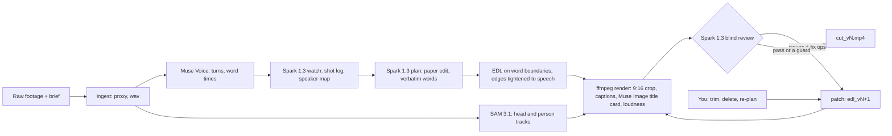

<p align="center">
  <picture>
    <source media="(prefers-color-scheme: dark)" srcset="assets/brand/svg/montivo-lockup-dark.svg">
    
  </picture>
</p>
<p align="center"><b>The video editor that watches its own cut.</b><br><code>plan → render → review → re-cut</code></p>

# Montivo

An agent-first video editor built on Meta's models. Give it spoken footage and a one-line brief: it picks the lines,
cuts on word boundaries, keeps the speaker in a 9:16 frame and captions it, then **watches its own render, turns
what is wrong into timed edits and renders again**, until the cut passes or a guard (budget, passes, a regression, a
repeated fix) stops the loop. Every version stays visible, and every edit, the agent's or yours, can be undone.

## See the correction

Run 015, Billy's own 69 s talking head (about $0.30 for the run and its review loop):

1. **Version 1 scored 68.** The blind reviewer, which gets the rendered video but never the plan, found the title card
   sitting on 1.5 s of silence and a caption that read "Soundtracks me so" where Billy says "SAM tracks me so" (Muse
   Voice had misheard it).
2. **The agent fixed both itself.** The two issues came back with a time in the cut and a fix op; the patcher dropped
   the card and retexted the line, rendered version 2 and reviewed it again: **81**.
3. **A person fixed the rest.** The reviewer still flagged two captions where Voice misheard Billy; he retyped those
   lines in the editor (four in all). Version 5 scores **87 with the measured checks clear** (`runs/015/review_v5.json`).

The Loop view shows exactly that: each version's frame and score, and between two versions what made the second one,
the reviewer's fix or a human edit, labelled. When a fix makes things worse the agent keeps the earlier cut: on a
hosted test upload the reviewer's own hook swap scored 48 against 74, and the regression guard kept the 74.

**Judges:** the hosted link and password are in the submission. Open a finished sample, press **Loop**, compare the
issue, the fix and the result, then make an edit of your own. Details under [Try it](#try-it).

## Built on Meta models

| Role | Model | What it does |
|---|---|---|
| Eyes and judgement | **Muse Spark 1.3** | shot log and speaker map (`watch`), paper edit by turn id with verbatim words (`plan`), the blind rubric review with fix ops (`review`), the Ask Montivo router |
| Open-weight planner | **Muse Spark Open** (on Baseten) | the paper edit (`plan`) when you pick it, in place of Spark 1.3: see [Open weight](#open-weight-muse-spark-open) |
| Ears and clock | **Muse Voice Transcribe 1.0** | turns, speakers and word timings of the footage, and each rendered cut transcribed again so the review can check its edge words |
| Camera operator | **SAM 3.1** | tracks the speaker's head (5 fps) for the 9:16 reframe and the person plus any callout concept per frame; the cutout on a cover |
| Art department | **Muse Image 1.0** | title card and B-roll stills |
| Hands | ffmpeg + Pillow | proxies, audio, trims, crop path, caption and callout overlays, the music bed and its ducking, loudness, H.264 |

Every runtime model is a Meta model. Every call's request and response JSON lands in the run folder next to a
ledger of tokens, dollars and seconds per stage.

## Evidence and limits

- **A development benchmark** (27/10): four fault types planted in three finished cuts, 28 blind reviews. 91 % of the
  planted faults were flagged as blocker or major; 2 of 22 faulty cuts still passed; 3 of 4 reviews of clean cuts
  passed. The checks and the planted faults were refined on these same cuts, so this is not a held-out error rate.
- **Unseen footage does not always pass.** Re-run on 28/10 with that day's code, a 4-astronaut NASA clip (66 at best:
  they talk over each other at every turn change), a USGS interview (68) and a multi-camera TEDx talk (70) improved or
  held but never passed. Montivo shows a bounded correction loop you can inspect; it does not promise a publishable
  cut on any footage.
- **The reviewer and the planner share a model family.** Withholding the plan removes one source of bias, not all of
  them; that is why measured checks (cut edges against the re-transcribed audio, the head inside the frame) can hold a
  pass the reviewer would give.

The full table is under [Measured results](#measured-results).

## Try it

**Judges:** Montivo runs hosted for you, with our Meta key on the server. The link and the password are in our
submission. Two finished projects open there, and you can upload your own clip (up to 90 s) and let the agent plan,
cut, review and re-cut it; your edits go to your own copy, so every judge starts from the same samples. A shared
budget caps the Meta model calls; past it, the finished projects and the $0 edits still work.

Locally, without an API key:

```bash
make dev    # Python 3.12 venv, needs ffmpeg and ffprobe on the PATH
make test   # the offline tests (recorded Voice and SAM streams, no network)
```

With a key (`MODEL_API_KEY`, dev.meta.ai), on your own footage:

```bash
make dev
export MODEL_API_KEY=...
.venv/bin/montivo run footage.mp4 --brief "A 40 second vertical reel: ..." --target 40 --review --out runs/001
make ui
```

## How the loop works

Montivo makes the correction loop visible: rendered video, timed issue, edit, new render. (Of the 16 AI video
editors whose public pages we read on 27/10, none described reviewing its own render; that is a reading of their
pages, not a test.) In detail:

- **A blind reviewer.** Spark 1.3 gets the rendered vertical cut (with a clock burned in, because it sees about one
  frame per second and no timestamps), the brief, a rubric and four measured facts: the silences in the cut, where
  every caption sits against the speaker's head box, the source audio level at both edges of every cut (a model
  does not hear a clipped syllable; the waveform does) and the caption timeline (a line up under a second can fall
  between the frames it sees). It never sees the plan or the edit list.
- **A pass the reviewer cannot give alone.** Muse Voice re-transcribes every cut and two measured checks run on it:
  a kept word at a cut edge that the cut no longer says, and the speaker's head outside the 9:16 frame for 0.5 s. A
  loud cut edge, a caption forced over the head, either check, or a reviewer blocker or major still open holds the
  pass (two exceptions, both on record: brief coverage, since the planner reports a brief line the footage never
  contains, and a caption a person retexted against the recording), and each measured fault becomes a fix of its own. The loop keeps a version that passes over a higher score
  that does not.
- **Fix operations, not prose.** Every issue comes back with a time in the cut and one of nine fix ops (`move_cut`,
  `drop_span`, `extend_span`, `swap_hook`, `reorder`, `caption_fix`, `retime_callout`, `reframe_bias`, `none`). The
  patcher maps the time to a span, a cut, a caption line or a callout and writes the next `edl_vN.json` with a
  `patches` record of what changed and why. Then it renders and reviews again.
- **A hook A/B the reviewer decides.** `montivo hook` makes a version that opens on another line (the one the reviewer
  itself asked for, else the planner's), renders it, reviews it blind next to the current one and keeps the better
  opener, with both scores and the reason on record.
- **Guards, so the loop cannot wreck the cut:** at most 3 reviews, a dollar budget checked before each one, the same
  fix twice stops the loop, a version that scores below the best stops it and the best is kept, the hook is never
  dropped whole, and a clipped word is fixed by moving its edge to the quiet point, never by deleting the word.
- **Time comes from Voice, never from Spark.** Every cut lands on a word boundary from Muse Voice's word timings and
  is then tightened to the actual speech onset and offset in the source audio. SAM 3.1 runs the camera: the 9:16 crop
  follows the speaker's head with a smoothed path, and with two or more people on screen it follows whoever is talking
  (who holds the microphone, then whose mouth moves, then where watch places them; four of four astronauts on run 014).
- **A human stays in the loop.** In the editor you trim a clip by dragging its edge (it snaps to words), delete a clip,
  or type an instruction to re-plan. Each edit is the next version through the same patch path as the reviewer, so undo
  and redo walk the versions and nothing is overwritten.



## Measured results

| Footage | What happened | Cost |
|---|---|---|
| Billy's own talking head, 125 s, a lean on camera, ums, a repeated take (run 012) | the full run in 242 s wall; the review loop took v1 from 76 to 100 and passed | $0.50 for the run, $0.06 for the loop |
| The same clip with a deliberately broken v1: a cut inside a word, a caption over the face, a weak hook | the blind reviewer caught all three faults with a timestamp in 3 runs out of 3; the loop took it from 65 to 85 and passed | $0.08 for the test, $0.06 for the loop |
| A public-domain USGS interview, 166 s, a noisy atrium, a second speaker, passers-by (run 013) | 62 to 68 to 72, no pass; it exposed three bugs the first clip never hit, all fixed (captions avoided every passer-by's head, a flagged title card stayed, a fast speaker's clipped words) | $0.78 |
| Reviewer benchmark (27/10 night, the reviewer as of that night, with the measured checks and the pass gate): four fault types (a weak hook, a cut inside a word, a wrong caption, the head out of frame) planted in three finished cuts, 28 blind reviews | 91 % of the planted faults caught as blocker or major; 2 of 22 faulty cuts still passed (9 %); 3 of 4 reviews of clean cuts passed (75 %); the same cut reviewed twice differs by 4.3 points (SD) | $0.80 |
| Three unseen clips re-run with that day's code (28/10): NASA, 4 astronauts, one mic; the USGS interview; the TEDx talk below | no pass on any: NASA 58 to 66 (the astronauts talk over each other at turn changes), USGS 68, TEDx 62 to 70; the bugs they exposed are fixed | part of $1.67 for the day |
| A TEDx clip uploaded through the hosted demo, 84 s, multi-camera, the speaker small in the wide shots | upload, run and loop in the container in 209 s: 72 to 76, no pass ($0.32); after a caption fix, a re-review (74) let the loop try the reviewer's swap_hook: that version scored 48 and the regression guard kept v2 ($0.07) | $0.39 |

The first two rows were scored by the reviewer of 26/10, before the measured checks and the pass gate (27/10), and are
not re-scored here. The benchmark is a small development sample (`tools/reviewer_bench.py`, `runs/bench/results.md`):
the checks and the planted faults were refined on these cuts, so it says what the reviewer catches on them, not a
general error rate. A 150 s source comes to about $0.48 with the review
loop. Every number above is in the run's `ledger.json`; how each one was measured is under "Measured behaviour" below.

## Open weight: Muse Spark Open

**Where it runs.** One stage runs on Meta's open-weight model: the **plan**, the paper edit that picks the lines, their
order, the hook and the callouts. Choose "Spark Open" in the planner menu on New project or in Ask Montivo (the hosted
demo has it), or `--planner open` on `montivo run` / `montivo plan`. The call goes to Muse Spark Open
(`meta-models/muse-spark-open-1026`) on Baseten Model APIs (`https://inference.baseten.co/v1`) as an OpenAI-compatible
chat completion with the same prompt and the same strict JSON schema Spark 1.3 gets; its answer is logged in the
run's ledger like any other call. Everything downstream (the EDL on Voice's word boundaries, the render, the blind
review loop, the editor) is the same code for both planners.

**Why that stage.** The plan is the one model call that needs no picture and no sound: it reads Muse Voice's turns and
word timings and the shot log as text and answers in JSON. Watch and review stay on Spark 1.3 because they must see
and hear the footage. We measured that too: in the reviewer benchmark (27/10, `tools/reviewer_bench.py`) Spark Open
read the cut's frames but heard nothing, caught the planted faults as often as Spark 1.3 (82 %), but scored clean cuts
15 to 20 points lower and never passed one, so it does not judge the cuts.

**Measured A/B, same footage, same brief** (run 012, Billy's 125 s talking head, `plan_compare_v1_v3.json`):

| | Spark 1.3 | Spark Open |
|---|---|---|
| Spans, length (target 45 s) | 9, 44.6 s | 9, 45.3 s |
| Words quoted verbatim, passages left unplaced | 100 %, 0 | 100 %, 0 |
| Hook | "Hi. I'm Billy. I run a small digital marketing agency in Athens" | the same line |
| Plan call cost and time | $0.050, 35.3 s | $0.012, 6.8 s |

Same hook and ending and 8 of 9 passages in common; Spark Open opened the body on "for the Meta Hackathon we are
building Montivo" where Spark 1.3 kept a stumbling take. Its first cut then went through the same blind review and
passed (88, 27/10). A second run, an Ask Montivo re-plan of run 015 to "about 30 seconds" on Spark Open,
came back in 14 s for $0.011 and kept both callouts. Two runs are not a benchmark: on these two the open model
planned the same structure as Spark 1.3 at about a quarter of the cost and a fifth of the time, and we claim no more
than that.

## The editor

`montivo serve` (or `make ui`) serves the editor at http://127.0.0.1:8765 over the run folders. Each project's card
shows the version the editor opens on (a poster frame from that cut, its name and length), its blind score, and a
sparkline of every reviewed version's score. The list sorts (newest, best score, name), filters (all, reviewed,
passed) and searches the name, run, footage and brief; the archive button on a card moves the run folder to
`runs/_archive/` (Undo in the toast, Restore under "Archived"), never deletes it. New project shows the clip with
its length, prices the run from that length (about $0.045 + $0.0026 per footage second, plus about $0.07 for the
review loop and $0.04 for the hook A/B, measured on runs 014 and 015), offers brief presets (talking head, interview,
product demo, event recap) and switches for punch-ins and the hook A/B (`montivo run --hook-ab`). The project list
starts a new run (upload, brief, target length, review loop, and the planner: Muse Spark 1.3 or Muse Spark Open, the
open-weights model on Baseten, which needs `BASETEN_API_KEY`; the reviews stay on Spark 1.3). The editor has a 9:16 viewer; a multi-track timeline
(the title card, captions, video with a filmstrip, audio with a waveform) with the reviewer's issues as markers on the
ruler, zoom and a transcript view of the paper edit; an inspector for the selected clip, the title card or the review
of the whole cut (score, the facts, the rubric, and each issue as saw, op, patch, result with the frame the
reviewer saw); the Assistant with the agent's stages live from `run.log` and a chat that re-plans from an instruction;
the versions with Compare (two versions side by side on one transport); the ledger; Export; and a replay mode (1x or
4x) that plays a finished run back with the dollars counting up, for recording. Punch-ins have a switch in the
inspector (on or off makes the next version) and pink markers on the video track, one per zoom (a dashed line for a
jump cut's scale); select one to see the word, its level and the frame, and remove it (or press Backspace) for the next
version without it. "Try another hook" in the review inspector runs the hook A/B on the version you are on (one or
two blind reviews, about $0.04 to $0.07) and opens the version it kept; earlier A/Bs from that version show their
verdict there. The Ask Montivo box has the same planner choice as a new project. The Loop film (`#/run/<id>/loop`, the
Loop button in the top bar or Versions) lays every version out left to right: the frame, the blind score and its
change, the reviewer's worst notes (a tick where a later version fixed one), and between two versions what made the
second one: the reviewer's fixes with the score each moved ("drop title · Hook in 1.5 s 2 → 10"), a human edit, a
re-plan with its planner, cost and time against v1's, or a hook A/B with its verdict, and a Compare button for the pair.
A running job (a new run, Ask Montivo, an edit, a review, the hook A/B) shows where it is, in the top bar, the Assistant
and its card on the project list: the step (plan, edges, render "segment 2 of 3", review, hook A/B), a clock against the
step's expected time (this run's earlier calls in `ledger.json`, else the measured hints: plan 35 s on Spark 1.3, 7 s
on Muse Spark Open, review 26 s) and a bar that moves by time but never past the last checkpoint `run.log` logged
(Voice, SAM and Watch on a new run have no estimate, so their bar says so); replay drives the same view. The viewer has safe-area guides (Reels, TikTok, Shorts, approximate; G cycles them), N and Shift+N jump to the next
and previous reviewer issue, and Versions marks the version the project opens on apart from the loop's best. Export is
a page of its own: a cover frame (scrub to pick it, with the Instagram profile grid's 3:4 crop shown, or "Let Muse Spark
pick": one call on the version's review copy, the blind review's upload reused, names three moments with a reason each,
and each lands on the sharpest frame within 0.25 s; $0.018 on run 015 v5) and the file name; the destination (1080 x 1920 as rendered, Feed 4:5 at 1080 x 1350 for the Instagram and Facebook
feed and LinkedIn, Square 1:1 at 1080 x 1080, or a 720 x 1280 copy for messages; no bitrate knobs, the apps re-encode
anyway); what goes in the bundle (the video, the video without burned-in captions, rendered again from a
copy of the EDL so the run folder never changes, SRT, WebVTT, the cover and its grid crop, WAV, a transcript; more
than one file comes as a zip, `python -m montivo.export`, $0); and a pre-flight read from the EDL and the review:
the gated blind review, -14 LUFS and the peak, the format, the length against Reels, TikTok and Shorts, and how many
caption lines and callouts reach into each app's own UI (the viewer's safe-area guides; on run 015 v5, 25 of 28
lines sit low enough to meet TikTok's caption, which the Style panel's fixed position fixes). Feed 4:5 and Square 1:1
render the version again from a copy of its EDL (EDL `target.aspect`, `engine/frame.py`, `python -m montivo.export ...
--aspect 4:5`, $0, about 12-30 s): the crop is still the full source height, only narrower (864 px of a 1080 p source
for 4:5), and still follows the head; every height the EDL holds (the caption top, a fixed position, a pinned callout)
is a 1920-frame y scaled by the frame's height, so it keeps its place against the face, and a feed frame keeps only a
6 % margin instead of the Reels / TikTok UI band, since a feed post has its buttons outside the picture (with the 9:16
band every 4:5 caption of run 015 v5 went above the head; with this one all 28 sit on the chest, and the callouts that
sat on the head in 9:16 sit above it). A phone clip narrower than the aspect keeps its width and loses height around
the head. The cover is that frame's still and its grid crop the 3:4 middle; the pre-flight lays the captions out in
that frame without rendering and says the app safe areas are a 9:16 matter. The 9:16 render is unchanged to the bit
(every decoded frame and the audio of run 015 v5 compared before and after). The Text panel rewrites, adds or removes callouts and turns
the title card off or on ($0) or gives it new words (one Muse Image call, $0.01), staged into one version like
captions; dragging a clip's body on the video track moves it (the reviewer's reorder op, the cuts that now meet
tightened again, roles by position); the Speakers panel shows every Voice speaker with the head the speaker map
gave it and every SAM head as a thumbnail, and pins another head for a speaker (EDL `reframe_speaker_ids`). All three
are `python -m montivo.human text | reorder | pin` and render the next version. The Music panel puts a music bed
under the speech: eight CC0 tracks from OpenGameArt bundled in `montivo/music/` as loops (lo-fi, hip hop, funk,
city-pop, acoustic, ukulele, new jack swing; authors and pages in the README there), so no model and no licence fee is
involved; a preview of each loop, the level where nobody speaks (default -20 LUFS) and how far it drops
while anyone speaks (default -12 dB), staged into one version ($0, `python -m montivo.human music RUN --track ID
[--level -20] [--duck -12] | --off`); the panel shows what the render measured, the speech's level over the bed. The Transcript view edits like a
document: click or drag over words (Shift-click extends) and press Backspace; the confirm shows the words, the seconds
and what happens to each clip, and the selection becomes one version through the engine's own ops: a whole clip is
dropped, words at a clip's start or end are trimmed like a timeline drag (reviewer rules), and words inside a clip
split it in two (`python -m montivo.human cut RUN --words s2:19-19`). No edge settles or widens back over the deleted
words, which matters because Voice's word edges abut and can sit a few hundred ms off (run 015: "checks its | own
work" is one run of speech). Keys: Space, J/K/L, arrow keys for
one frame, Backspace to delete a clip, Cmd+Z / Shift+Cmd+Z across versions. Spoken instructions through Voice: not
yet. The server only reads the run folders and starts the engine as a subprocess; the React build is committed, so
the editor needs Python only.

Edits after the first cut, all through the same versions: S (or Cmd+K) splits the clip at the playhead, trims and
moves snap to the playhead, clip edges and issue markers (N turns snapping off, Shift drags free), Shift- or Cmd-click
selects several clips for one delete; the Transcript shows the words the plan left out, and Insert (or a ghost clip's
"Bring it back") puts a passage back in source order (`python -m montivo.human insert`); "N pauses, -X s" removes the
pauses the audio has between abutting words, cut at the nearest word edge (`human pauses`); the B-roll track asks Muse
Image for a still from a prompt and lays it under the captions, tied to its words, full frame, as a card or in the
corner away from the head (one call, $0.01; moving, resizing and removing it are $0); Restore copies an older version
forward as the next one with its review. Ask Montivo is an agent over those operations: one Spark 1.3 call (about
$0.005) reads the message next to the version (its clips, caption lines, look, music and last review) and picks
operations from a closed list (music, style, captions, callouts, title, drop, reorder, cut, re-plan, review), run as
one version and rendered once; a structural change (re-plan, drop, reorder, cut) or anything over $0.02 first comes
back as a card with the change, its cost and time (Apply, or Try something else), a question gets an answer and no
version, a selection of clips, words or a caption line scopes the request, and a message typed during a job waits
for it. Share makes a read-only page for
one version (`/s/<token>`: the cut, its score and score history, the top notes; Unshare removes it). On the Export
page the cover maker lays a headline over a still (frame, headline, sticker, or a cutout with the headline behind the
speaker, cut out by SAM 3.1 from that one still, $0.010), or "Design it with Muse Spark" picks the still from a
numbered contact sheet, writes the headline, checks the cover and its grid tile and fixes it once ($0.011 on run 015);
"Post text" writes a title, description and hashtags for Reels, TikTok, Shorts and LinkedIn (one call, about $0.01).
The Voice and Music tracks of a version with music have a fader each that plays live in the browser before "Make
Version" renders the mix. Under 900 px the editor is a review mode (player, review, chat, export).

## Built during the hackathon

Everything in this repository was written from scratch for the Meta Global AI Developer Hackathon, from the kickoff
(26/10/2026, 12:00 PM ET, 18:00 Athens time) on; the first commit (`9d9f0ec`) is from 26/10 at 19:10 Athens time. One
exception, removed since: a set of throwaway API test scripts started before the kickoff (see Before the kickoff,
below). What was built during the event covers the engine
(`montivo/engine/`: the API clients, ingest, Voice, SAM tracking, the Spark calls and schemas, the EDL, the edge pass,
reframe, render, captions and graphics, the title card, the review loop, the speaker mapping), the run, ledger and CLI,
the human edits (`montivo/human.py`), the API server and the React editor (`montivo/server/`, `web/`), the tests and
the brand (`assets/brand/`: the symbol, wordmark, colours, cards and sting, all generated by `build.py`).
Used as they are: ffmpeg, Pillow, httpx, FastAPI, React and Vite, and the Inter Tight, JetBrains Mono, Montserrat, Anton, Poppins and DM Serif Display fonts (SIL OFL 1.1). The concept
and the name come from an earlier personal project of Vasileios (Billy) Gkaravelos; none of its code is used here.

The demo video is narrated off camera by an AI voice cloned from Billy's own recording (an ElevenLabs instant clone,
made through Magnific). The clone is used only for the video; Montivo itself calls Meta models only.

## Pipeline in detail

Works end to end from raw footage to a finished 9:16 cut with captions, callouts, a title card and loudnorm, then
reviews its own cut blind and re-cuts:

```
montivo run footage.mp4 --brief "..." --out runs/001
  ingest   ffprobe, 960 px proxy at source fps, 24 kHz mono wav, one Files API upload reused by every Spark call
  voice    streaming DIARIZATION -> turns[] + words[] (lag-corrected, snapped to speechStart/speechEnd)   \
  track    SAM 3.1 "person" and "head" at 5 fps (one upload) over httpx SSE, regex boxes -> track/<concept>/tracks.json | in parallel
  watch    Spark 1.3 + proxy + transcript -> shot log, speaker map, concept suggestions, b-roll, movement moments /
  speakers (2+ voices, 2+ heads) mouth-minus-eyes motion of every SAM head vs the Voice word times of every speaker
           -> speakers.json (head ids per speaker; watch's "left/right/centre" as the fallback), $0, ffmpeg + Pillow
  plan     Spark 1.3 + brief + shot log + movement moments + measured speech rate + transcript -> paper edit (turn id + verbatim words)
  edl      spans mapped to Voice word boundaries, then every cut edge tightened to the speech in the source audio
           (0.1 s before the onset, 0.15 s after the offset, 0.3 s at the very end) -> edl_v1.json
  reframe  per segment: the head track (person as fallback), the talking speaker's head when speakers.json maps one, else the
           largest and most centred id -> smoothed 9:16 crop path (dead zone, EMA, pan clamp)
  title    Muse Image 1.0: the plan's title_card_text -> title/title_card.png (generated once, $0.01)
  captions Voice words of the kept spans -> de-doubled, glossary-corrected, 1 to 4 word lines up at least 0.4 s each, placed
           clear of the SAM head box;
           the plan's per-span callouts anchored to the SAM person box -> transparent PNGs (Pillow)
  punch    (--punch) zooms on the loudest content words and an alternating scale across jump cuts, about the head
  render   ffmpeg from the SOURCE: 1.5 s title segment with a fade, then frame-aligned segments, sendcmd-driven crop, overlays
           burned in after the scale, 1080x1920 H.264; audio cut in one pass, 1.5 s of silence in front, two-pass loudness
           (measure, then one fixed gain to -14 LUFS, a 4x oversampled limiter when the peaks need it) -> cut_v1.mp4,
           measured again with ebur128; with EDL `music` a bundled loop under the normalised speech, ducked along the
           Voice words in cut time, the mix normalised again (-14 LUFS, true peak of the AAC file under -1 dBTP)
  review   (--review) Spark 1.3 watches cut_vN blind -> rubric scores + fix ops -> EDL patch -> edl_vN+1 -> render cut_vN+1, repeat
montivo render runs/001 --out cut_v3.mp4   re-render from edl_v1.json + voice.json + tracks, ffmpeg only (the title card is
                                           generated once if missing, --no-title to skip it)
montivo review runs/001                    the review loop on a finished run folder: review cut_v1, patch, render cut_v2, review ...
montivo edges runs/001                     the edge pass on an EDL built before it existed ($0; the old EDL kept under check/)
montivo speakers runs/001                  which SAM head is which Voice speaker ($0) -> speakers.json; the next render follows it
montivo plan runs/001 --planner open       a fresh paper edit from the run's brief, voice and watch on Muse Spark Open (Baseten)
                                           -> the next edl_vN / cut_vN beside Spark 1.3's v1 (the Open Weight A/B, one call)
montivo hook runs/001 [--edl edl_v2.json]  hook A/B: the next version opens on another line, both reviewed blind, the better
                                           one kept (review/hook_ab_vA_vB.json); `montivo review ... --hook-ab` runs it on
                                           the loop's best version
```

The review loop: the reviewer gets the cut (scaled to 720x1280 with a cut-time clock burned in at the top left), the brief,
the rubric and four measured facts, never the EDL: the silence gaps ffmpeg `silencedetect` finds in the cut, every
caption box against the SAM head box, the speech level of the source audio right at both edges of every cut (added
after kill test (b): Spark never hears a clipped word) and every caption line's text and cut times (added 27/10: the
0.4 s "Hi." opening run 012-open's cut_v3 fell between Spark's frames and was flagged missing; with the timeline the
same cut drew no such issue). It names times in the cut, not spans; `engine/review.py` maps each time back to a
span, a cut point, a caption line or a callout and turns blocker and major issues into EDL patches (`drop_span`,
`extend_span`, `move_cut`, `swap_hook`, `reorder`, `caption_fix`, `retime_callout`, `reframe_bias`; a title card the
reviewer flags is dropped with `title_card: false`). Guards: at most 3 reviews, a dollar budget checked before each review
(`--budget`, default $0.30), at most 4 fixes per pass, the same fix proposed twice stops the loop, a pass that scores
below the best so far stops it, the hook span is never dropped whole, and a drop over part of a span trims only the words
in the reviewer's window at that end. The fixes of one pass are applied in turn and each is checked against the EDL the
earlier ones made (a move next to a span another fix dropped, or a drop that would leave one span, is skipped and
recorded), and a new version always takes the next free number, so reviewing an old version never overwrites a later one. Word-level edits land on a sentence end when one is a word away and then settle on
the quietest 40 ms of the source audio within 0.3 s (Voice words abut, so only the audio shows the gap) and are then
tightened to the speech like v1; a clipped word is fixed by moving its edge to that quiet point, never by removing words.

The editor on top of this is described under "The editor" above.

## Setup

Requirements: Python 3.12, ffmpeg and ffprobe on the PATH, a Meta developer API key.

```bash
make dev                      # python3.12 venv in .venv, installs montivo and pytest
export MODEL_API_KEY=...      # from dev.meta.ai, never committed
.venv/bin/montivo run footage.mp4 --brief "A 30 second vertical teaser: why launching from US soil again matters." --out runs/001
```

The demo brief for Billy's own clip (`footage/billy_demo.mp4`, DJI selfie mode, so `--hflip`), verbatim:

```bash
.venv/bin/montivo run footage/billy_demo.mp4 --hflip --target 40 --out runs/011 --brief "35 to 45 s vertical reel: what Montivo is and why the review loop matters. Keep the hook (Hi, I'm Billy). Keep the line about the four Meta models through 'SAM tracks me so the vertical crop follows me when I move, like right now': that is the moment I move on camera, it must stay in the cut. Drop the Greek pre-roll, the pauses, the ums and the repeated take (keep only the second 'this is the part that matters'). End on 'Raw footage in, a reviewed cut out'."
```

Useful flags: `--target 40` (seconds of speech to keep), `--concept "mission patch"` (extra SAM concepts, repeatable;
SAM is one request per concept, so each one costs about $0.125 per 125 s at 5 fps, and the concepts `watch` suggests are
only logged as `watch suggests: ...` with that price, never tracked on their own), `--hflip` (mirror the footage once
before everything else: selfie / mirror-mode clips where on-screen text reads backwards; writes `<run>/source_hflip.mp4`
with libx264 crf 18 and the audio copied, and that file is the source for the proxy, the wav, SAM and the render, so no
box or crop is ever flipped afterwards; recorded in `ingest.json` and in the EDL's `source`),
`--track-fps 10` (default 5 fps for every concept, the head track's rate, so person and head share one upload), `--reframe-concept head` and
`--reframe-fps 5` (the track the crop follows; `none` falls back to the person track), `--no-track`, `--plan-with-video`,
`--plan-effort low|medium|high`, `--punch` (punch-in zooms, see below), `--review` (the review loop after cut_v1; `--review-passes 3`, `--review-budget 0.30`), `--resume` (reuse ingest, voice, watch and tracks already in the run folder, and `plan.json` + `edl_v1.json` while
the brief, target and planner are the ones the plan was made with; `--replan` forces a new plan, and a new plan first
keeps the old `plan.json` and `edl_v1.json` in `superseded/` and names any later `edl_vN` built on it in a warning), `--language none`, `--no-render` (stop at `edl_v1.json`), `--no-title` (no Muse Image title card,
saves $0.01), `--no-captions`. `montivo render runs/001 [--edl ...] [--source ...] [--out cut_v3.mp4] [--no-title]
[--no-captions] [--no-callouts] [--no-loudnorm] [--punch | --no-punch]` renders an EDL again from the run folder's `voice/voice.json` and tracks;
it calls no model, except Muse Image once when `title/title_card.png` is missing or was made for another title text.
`montivo review runs/001 [--edl edl_v1.json] [--passes 3] [--budget 0.30] [--no-clock] [--no-apply]` runs the loop on a
finished run folder (only Spark review calls, about $0.03 each, $0.012 when the same cut is reviewed again and the video
tokens come from the cache); `--passes 1` or `--no-apply` reviews once and writes the proposed fixes without patching.
`montivo edges runs/001 [--edl edl_v1.json] [--dry-run]` tightens an EDL that was built before the edge pass existed: it
rewrites the EDL in place (the old one goes to `check/<name>_before_edges.json`), clears the render fields so the next
`render` or `review` renders it again, and logs every move; a second run moves nothing.
Open Weight planner: `montivo run ... --planner open` writes the paper edit with Muse Spark Open on Baseten Model APIs
(`config.OPEN_MODEL`, default `meta-models/muse-spark-open-1026`, `MONTIVO_OPEN_MODEL` / `MONTIVO_OPEN_BASE_URL` override;
`BASETEN_API_KEY` in the environment, checked before any spend; a reasoning model, so the call asks for effort low
unless `--plan-effort` says otherwise: at the default effort a short probe spent every token on reasoning). The plan is the one call that needs no video, so the
same prompt and strict JSON schema go out as an OpenAI-compatible chat completion (`response_format` json_schema),
the answer is read back in the Responses shape and logged in the ledger like any Spark call; watch and review stay on
Spark 1.3. `montivo plan runs/001 --planner open` does it on a finished run folder: a fresh plan from the run's own
brief (blind to the current cut), the next `edl_vN` with a `replan` patch that names the model, rendered, so the UI's
Compare shows the two planners side by side; `--review 3` runs the loop on it. The A/B numbers (spans, runtime,
verbatim rate, unplaced passages, the hook, what each plan call cost and took) go to `plan_compare_v1_vN.json`, the
run log and the command's output. Measured on a copy of run 012 (27/10): Muse Spark Open placed 9 spans, 45.3 s, every
one verbatim, nothing unplaced, the same hook and ending as Spark 1.3 and 8 of its 9 passages (it opened the body on
"for the Meta Hackathon we are building Montivo" instead of the stumbling "the editor it's an agent agent"), for $0.012
in 6.8 s against Spark 1.3's $0.050 in 35 s; the blind reviewer gave that first cut 92 and a pass (Spark 1.3's v1 had
76 before the loop, its reviewed v2 100). It marked every body span `payoff` (the prompt gave only the label names),
so the hook A/B took a middle line as the punchline; the plan prompt now defines each role and `build_edl` sets them by
position for any planner (one `hook` first, the `payoff` last, `cta` only after it, `body` between; a changed label
keeps the planner's in `planner_role` and `role_fixes`).

Hook A/B (`engine/hook.py`, `montivo hook runs/001 [--edl edl_vN.json] [--budget 0.10]`, or `montivo review runs/001
--hook-ab [--hook-budget 0.10]` after the loop): version A is the EDL as it is, version B the next free version with one
`swap_hook` patch through the reviewer's own patch path (the challenger moved to the front, every other span in A's order,
the old opener kept as a body span), rendered and reviewed blind; the higher (pass, overall) is kept and a tie keeps A.
The challenger is chosen deterministically: the line the reviewer asked to open with (a `swap_hook` target in this run's
reviews, newest first), else another span the planner marked `hook`, else the planner's `payoff`, the ending (a cold open),
else the first span after the opener that starts a new passage. A's review is reused when `cut_vA` was already
reviewed (then the A/B is one review, about $0.03; two reviews about $0.06 on a 45 s cut), the budget is checked for
every review still needed before the first one, a challenger already compared against the same A is not tried again,
and nothing is overwritten. The reviewer varies by about 10 points on an identical cut, so the record says whether the
margin reaches that (`decisive`). Both versions, the challenger and why, both scores with the hook criterion, the
winner and the reason go into `review/hook_ab_vA_vB.json` and into B's patch entry (`source: hook_ab`, `result`); the
editor labels B "hook A/B" and the Assistant says which version was kept. Real runs so far: on run 012-open the
challenger (the payoff as a cold open) scored 81 against A's 88 (hook 3 against 10), on run 015 69 against 82; both
times A was kept.

Speaker to head mapping (`engine/speakers.py`, run step and `montivo speakers runs/001`): with two or more voices and two
or more heads, the microphone comes first. When watch saw one, the run tracks it with SAM on the head track's frames
(one request, about $0.12 per 120 s); per frame the head whose box is nearest the mic's box (the gap over the head's
height, within 1.5) holds it, and a speaker gets the head that holds it on at least 60 % of the frames where only that
speaker talks; a mic object that never moves is dropped (SAM also called a fixed fitting a microphone). For the
speakers and heads the mic leaves, every head box gets a mouth-minus-eyes motion series on the 5 fps grid SAM saw (mean absolute frame
difference in the lower 40 % of the box minus the 10 to 45 % band, so a nod or a camera move cancels out), compared per
speaker between the frames where only that speaker talks (Voice word times) and the frames where they are silent; a
head goes to the speaker whose effect size is at least 0.4 and 0.2 over the runner-up, two heads on screen together
never share one, and a speaker left without a head takes the one at the position watch's speaker map names. The
render then plans each segment in pieces, one per speaker run, each following that speaker's head (`pieces` in the
EDL's `render.segments`); captions keep clear of the head followed at that moment. Off-camera voices and single-speaker
clips keep the plain rule. A human pin in the EDL, `reframe_speaker_ids` {"A": "3"} (Voice label -> head id), replaces
the mapped heads of that speaker while the pinned id is in frame, with or without speakers.json, and survives a re-plan.
A head upside down (an
astronaut on the ceiling) is found from the person track (the head sits at the bottom edge of its body's box) and its
mouth and eyes bands are flipped. First real check, the NASA Expedition 72 Thanksgiving message (run 014, 120 s, four
astronauts in one shot, one handheld microphone passed around): without the mic all four voices went to the wrong head.
Watch's speaker map named the wrong person for three voices, and mouth motion carried too little (heads 54 to 122 px
wide at 5 fps, the mic over the mouth, the upside-down astronaut's own voice at -0.36 before the flip, +0.36 after).
With the mic ($0.12 more) all four map right, checked against who holds it in every Voice turn: shares 86, 100, 80 and
99.5 %. Distances between box centres had given the first voice to the wrong astronaut (the mic was held low, nearer the
next head down), and the fixed fitting the second; gaps and the stillness rule fixed both. A human pin,
`reframe_speaker_ids`, still wins over all of it.
Punch-ins (`engine/punch.py`, `--punch` on `run` and `render`, opt-in for now): a 1.12x zoom on the words the speaker
leans on (a word's level in the source audio at least 3 dB over the median of the kept words, 0.2 s or longer, four
letters or more, not a stop word; a caption highlight word such as Montivo at any level), at most one per 6 s of cut and
4 s apart, ramping in over 0.12 s to the word's onset, held 0.35 s past it and out over 0.25 s; and a 1.06x base scale
on a segment that opens on the head at the place and size where the previous one closed (a jump cut), so takes
of the same shot alternate. The zoom is about the median centre of the followed head, so the face grows where it is;
an event is skipped when the zoomed head would leave the top of the frame or touch a caption on screen. ffmpeg's crop
cannot change size per frame (the graph stalls), so the zoom is a `zoompan` after the scale and before the overlays:
captions and callouts never zoom. The EDL records `punch` (kept by the review loop and the editor's edits) and
`punch_ins` (kind, word, level over the median, cut times, zoom, anchor, and a `key` such as `emphasis:Montivo@47.120`
or `jump_cut:s4` that names it across versions). `python -m montivo.human punch runs/012 --on|--off` makes the next
version with the punch-ins on or off, `--skip KEY` the next version without that one: the key goes into the EDL's
`punch_skip`, which the review loop, trims, drops and re-plans carry forward, and a skipped punch-in keeps its place
(its slot in the one-per-6 s budget and the 4 s spacing, its turn in the jump-cut alternation), so removing one never
makes another appear elsewhere. First real use (27/10, run 012-open): 9 punch-ins (7 on emphasis, 2 on jump cuts),
the head stayed in frame and the captions did not zoom in the frames checked, the blind review 88 and a pass as
without them; in the editor, Remove and then the switch off made v6 with 8 and v7 with none.
Captions use `MONTIVO_FONT` when set, else the bundled `montivo/fonts/InterTight-800.ttf` (Inter Tight, SIL OFL 1.1, a
static wght 800 instance of the Google Fonts variable font), so line breaks and pixels match on every machine; Arial
Black, Arial Bold and DejaVu Sans Bold are fallbacks only (the path is recorded in the EDL's `caption_style.font_path`).
The look is a person's choice (EDL `look`, `engine/graphics.py`): six presets (marker, clean, box, karaoke, bold pop,
minimal), five bundled OFL fonts (Inter Tight, Montserrat Black, Anton, Poppins Bold, DM Serif Display; licences in
`montivo/fonts/licenses/`), colours, outline, shadow, a box behind the line, words per line, case, how the spoken word
shows (pill, colour, karaoke, none), extra highlighted words, and the caption position: auto (off the face, from the
look's height) or fixed (every line at one height). Callouts take the look's font and colours, and a person can pin
one where they dragged it (span `callout_xy`). `python -m montivo.human style RUN --look '{"preset": "box"}'
[--callout s5=120,300 | s5=auto]` makes the next version ($0); the review loop and its pass gate leave a fixed position
and a pinned callout where the person put them, and a re-plan carries both. The editor's Style panel shows each preset
on a real frame of the cut (and the person's own saved looks, kept for every project in `looks/`, one file per judge on the hosted demo) and previews every change on the paused viewer with the same Pillow code
(`engine/look.py`, about 0.4 s per still): what it shows is the new version's frame.
A look can also be asked for in words (`--prompt "bold yellow, one word at a time, higher"`, the Style panel's
Describe it box): one Muse Spark call with a strict schema of the look's fields (about $0.008, 8-12 s) gets the current
look, how light the picture is behind the caption rows (mean luma of the source frames under them) and the rows the
speaker's head covers, and answers the whole look with one line of why; out-of-range numbers are clamped, a bad colour
keeps the old one, and a fixed height that would sit on the face becomes auto (on run 015 its first answer put the
words on the mouth at y 1150 before the face rows were in the prompt and the guard existed).

The editor: `make ui` (or `.venv/bin/montivo serve [--port 8765] [--root .]`). It reads the run folders and starts the
engine as a subprocess (`montivo run ... --review`, `montivo review`, `python -m montivo.human drop|trim|replan|punch`); it never
imports the engine, apart from the caption look for the Style panel's stills (`engine/graphics.py`, `engine/look.py`). The React build is committed in `montivo/server/static`, so it needs Python only; after editing
`web/src`, `make web` rebuilds it (Node 18+). `python -m montivo.human drop runs/012 --span s3 [--from 2] [--review 1]`
and `python -m montivo.human replan runs/012 --instruction "..." [--from 2] [--review 1]` (and `python -m montivo.human
trim runs/012 --span s3 --edge out --word 12`, `python -m montivo.human punch runs/012 --on|--off|--skip KEY`) are the
editor's actions from the shell: the next version number is one past the highest in the folder, so nothing is overwritten; drop goes
through the reviewer's own `drop_span` patch and tightens the two edges that now meet ($0 without `--review`); replan is
one Spark plan call (about $0.04) on the stored Voice words and shot log with the instruction added to the brief, the
title card kept as it was, then the edge pass and the render. For a word Voice misheard, `python -m montivo.human caption
runs/015 --at 18.5 --text "Four Meta models do all" [--at ... --text ...]` gives the caption line on screen at that cut
second the words actually spoken (the reviewer's `caption_text` patch, timing kept, $0); in the editor, the Captions panel does the same (double-click a line or the pencil, then Make Version N).

## Run folder

```
runs/001/
  run.json  run.log  summary.json  ledger.json      what ran, every line logged, totals per stage (render is $0)
  ingest.json  proxy.mp4  audio.wav                 probe, 960 px proxy (uploaded once), 24 kHz mono wav
  source_hflip.mp4                                  only with --hflip: the mirrored source every later stage reads
  voice/  request.json  events.jsonl  voice.json    raw stream, turns[] and words[]
  track/  track_source_10fps.mp4                    the clip SAM saw (resampled when the source is over 60 s)
          person/ head/ request.json events.sse tracks.json masks.jsonl   (head: track_source_5fps.mp4)
  spark/  watch_request.json watch_response.json plan_request.json plan_response.json
  watch.json  plan.json  edl_v1.json                parsed outputs and the EDL on word boundaries
  title/  request.json response.json title_card.png   Muse Image call (image stripped from the response) and the card (1152x2048)
  render/ seg_00_title.mp4 seg_NN.mp4 seg_NN_crop.cmd audio.m4a concat.txt   title segment, one video segment per cut with its crop
          overlays/ cap_NNN_K.png callout_sN.png    path, the audio in one piece; one PNG per caption line and active word, per callout
  cut_v1.mp4                                        1080x1920 H.264 + AAC, the segments joined by stream copy
  review_v1.json                                    the review of cut_v1: facts, scores, issues, the fixes planned and skipped (why)
  review/review_v1/ cut_v1_review.mp4 clock/        the 720x1280 copy Spark watched with its clock frames; review/loop.json
  spark/review_v1_request.json review_v1_response.json
  edl_v2.json  cut_v2.mp4  review_v2.json ...       the patched EDL (`patches`: what changed and why), its render, its review
```

`edl_v1.json` spans carry `t_in`/`t_out` from the Voice words, `verbatim` (the planner quoted the transcript
exactly), `match_ratio` otherwise, and `contiguous_with_previous` when two spans join without a cut; `edges` records
every edge the edge pass moved (from, to, the speech onset or offset, a neighbour's fragment skipped, the level before and
after) and `edge_tuned` the edges the review patcher must not snap back; `edge_pass` holds the noise floor, the speech
threshold and the totals. After a render it
also carries `reframe` (crop keyframes every 0.5 s and whenever the camera starts or stops moving), `captions` (one entry
per line: text, cut times per word with what Voice heard where a correction applied, the box in output pixels, the head
box it avoided, `placement` lower_third / below_head / above_head / over_head, and its `corrections`), `callouts` (text,
times, box, the person and head boxes, placement), `caption_corrections` (every dedupe and glossary fix) and `render`
(segments with their frame counts, the track followed, the crop x range and overlay count; the title segment; the
loudnorm figures and the ebur128 measurement of the finished file).

## Measured behaviour the design rests on

- Spark 1.3 sees about one frame per second plus the audio, with no timestamps, so time comes from Voice, never
  from Spark. 1.3 fabricates quotes when asked to transcribe, so every Spark call gets the Voice transcript as text.
  Spark 1.2 degenerates with a strict JSON schema and video input; Montivo uses 1.3 only.
- Voice streaming (`partialMode: DELTA`, `emitAudioProgress: true`) emits word deltas stamped with
  `audioProcessedMs` on an 80 ms grid about 0.5 s after the audio. Word start = delta time minus 0.5 s, word end =
  next delta, first and last word snap to `speechStart`/`speechEnd` within 0.4 s. Checked by re-transcribing the
  cut spans: boundaries land on the right words, with up to about 0.3 s of slop inside continuous speech.
- SAM 3.1 must be streamed over raw SSE (httpx or curl): the OpenAI SDK stream dropped mid-way twice. Boxes come
  out of the text with a regex in milliseconds; the official parser needs minutes for the masks, so masks are kept
  as opaque payloads per frame and decoded only where a head anchor is needed. Ids are stable while the object stays
  in frame and do not reset on cuts.
- Cost of this stage on a 150 s source: Voice $0.01, SAM person at 10 fps $0.30 plus head at 5 fps $0.15, Spark watch
  $0.07, Spark plan (text only) $0.03, about $0.56 and 3 minutes of wall time ($0.47 on Billy's 125 s clip). SAM is
  one request per concept, so every extra concept costs the same again.
- Reframe on a moving subject (Billy's clip, 26/10): on a lean the head moves about 450 px at 1920 while the SAM person
  box centre moves 130 px (the box is torso plus arms), so a crop that centres the person box clips the face. The crop
  follows a separate "head" track at 5 fps instead, with the pan clamp at 450 px/s (1280 base) and an EMA of 0.25 s:
  on the 25 s lean block the head stayed fully inside the crop in 745 of 745 frames with no direction reversal, and the
  static NASA talking head still renders at one x.
- Render path (kill test (a) on the NASA clip): spans flagged contiguous render as one segment, every segment is
  snapped to whole source frames, video segments are joined by the concat demuxer with stream copy and the audio is
  cut from the source in one pass (atrim + 20 ms fades + concat filter). Re-transcribing the cut with Voice gives the
  span words in order with the first and last word of every segment intact. Joining per-segment AAC instead adds about
  47 ms of audio per segment (encoder padding) and the lip sync drifts by that much at every cut, so the audio is not
  cut per segment.
- Planner fill: with "aim for 40 seconds" alone Spark kept 20 s; told the range (target to 1.2x, never below 0.8x),
  the speech rate (2.5 words per second) and that one long turn may yield several spans, it kept 34.5 s and 32.8 s on
  two runs ($0.04 per plan call). It still pads with the interviewer's question when the speaker's own lines run short.
  On Billy's clip the same 2.5 constant made a 40 s target come out at 50.7 s (Spark's own estimate was 47.6 s): Billy
  speaks slower, 2.3 words/s measured by Voice over the spoken seconds of the turns. The plan prompt now takes the
  rate Voice measured on the clip (`VoiceResult.speech_rate`, 2.5 only when unknown) for the word range and the
  `estimated_runtime_s` rule. Run 011 on the same clip: Voice measured 2.09 words/s, the EDL came out at 47.7 s for a
  40 to 48 s range (was 50.7 s).
- Watch on Billy's clip (26/10) logged 2 shots for 125 s and no motion, so the planner dropped the one block where he
  moves (60.6 to 85.4 s). Watch now also returns `movement_moments` (speaker out of centre or handling a prop, with
  seconds) and the plan prompt lists them under the shot log. Run 011: watch returned the 82.5 to 85.6 s side-to-side
  lean among 5 moments and the plan kept that block (the brief asked for it too). `--hflip` on the same run: the EDL
  and the render read `source_hflip.mp4`, the head track stayed one id, the head was centred at all 9 checked points
  of the cut including the lean. Run cost $0.49 (hflip and render are $0).

- Finishing on run 011 (26/10, `montivo render runs/011 --out cut_v3.mp4`, ffmpeg only after one $0.01 Muse Image call):
  this ffmpeg build (Homebrew 9.0.2) has neither libass nor freetype, so `subtitles` and `drawtext` are unavailable;
  captions and callouts are Pillow PNGs burned in with `overlay` inside the segment encode, so the video is still
  encoded once. 29 caption lines, 96 word-state PNGs and 1 callout, render 25 s for a 49.3 s cut (the plain cut took 20 s). Voice
  doubled 3 words in the kept spans ("its its", "that's that's", "in in", each with 0 s gap) and misheard 4 names; all 7
  corrections are in the EDL. The SAM head box bottom stayed above y 971 of 1920 in every line, so all 29 lines kept the
  lower-third default (top at 1300) and none is over the face; the callout could not sit on top of the person box (the
  box starts 132 px from the frame top, inside the platform UI) and went inside the box under the head. Loudness:
  source -28.5 LUFS; loudnorm (dynamic, one pass) at -1.0 dBTP gave -0.8 dBTP after the AAC encode, so it now aims at
  -1.5 and the file measures -14.3 LUFS integrated, -1.3 dBTP, LRA 3.9 LU with ebur128. Muse Image returned the title
  "Raw In, Reviewed Cut Out" spelled correctly in 8.9 s.
- Run 012 (26/10, fresh API run, `--target 45`, same clip and brief): the whole path in one `montivo run`, $0.4986 and
  242 s wall (Voice $0.006, watch $0.057, SAM head $0.125 + person $0.250, plan $0.050, Muse Image title $0.010 in
  12.6 s, render $0 in 30 s). Voice measured 2.14 words/s; the EDL came out at 52.0 s for a 45 to 54 s range, 9 spans,
  100% verbatim, and the hook keeps "Hi. I'm Billy. I run a small digital marketing agency in Athens" (run 011 lost it);
  it drops "for the Meta hackathon I'm building Montivo", so the name is first heard in the payoff. The new Voice output
  had the same three name mishearings (metal models, MuseSpark, News Voice), all caught, no "ready viewed" this time,
  and 5 new doubles (agent, between, me, the, afterwards), all removed. "it's an agent", "the cuts lands", "the vertical
  crops follows" and "score it against the rubric" came out identical in runs 011 and 012, so they are most likely what
  was said and stay uncorrected. 33 caption lines, all lower third, 0 over the face (head box bottom at most y 1036 of
  1920); 1 callout ("4 Meta Models", below the head on the person box). Caption lines ran across sentence ends at span
  joins ("work Muse Spark", "that matters Spark", "middle of one SAM"): a line now also breaks where the span changes,
  which gives 35 lines in `cut_v2.mp4` with every planned sentence starting its own line. Loudness -14.3 LUFS, -1.4 dBTP,
  LRA 3.6 LU (ebur128); cut 53.5 s with the 1.5 s title. On the lean the head stays inside the crop but sits in the left
  third for about a second at the fastest swing (pan clamp at 450 px/s).

- Review loop (evening 4, 26/10 night, runs 012 and 012-ktb): Spark 1.3 at the default reasoning effort burned all 10,000
  output tokens of a 53.5 s review on reasoning and returned nothing ($0.06); at effort low a review takes 15.5K tokens in
  (about 280 per second of video), 2.2K to 3.9K out, 17 to 31 s and $0.025 to $0.036, $0.012 to $0.016 when the same cut is
  reviewed again (video tokens cached). On run 012's cut_v1 the reviewer flagged the 1.5 s title card as a hook blocker in
  3 of 3 reviews (hook 2/10, overall 67 to 68); the loop dropped the card and cut_v2 passed at 82 (one patch, two reviews,
  $0.046). It never flagged that "Montivo" is first heard at 47 s. The first loop, before two guards existed, made the cut
  worse: "extra backstory at 4.5 to 7.5 s" dropped the whole hook span with "Hi, I'm Billy", and a stutter the reviewer
  imagined ("Muse Vocal gives", the caption reads "Muse Voice gives") dropped the timestamp line (68, 66, 68). Hence: a drop
  over part of a span trims only the words in the window at that end, the hook span is never dropped whole, and a pass
  scoring below the best stops the loop. The reviewer misreads captions at 720x1280 ("Musi Voice", "digital marketers");
  a caption_fix whose text equals the line is skipped, and minor issues are never applied.
- Kill test (b), reviewer (26/10 night): a bad v1 of run 012 with the first take "Okay. So, hi, I'm Billy..." as the hook
  (about 3 s of filler), span s2 cut inside "agent" (the 40 ms before the cut at -15.5 dB) and the line "Muse Spark watches"
  forced over the face. 3 of 3 blind reviews caught 2 of 3 with the timestamp inside the fault (hook at 0.0 s, caption at
  15.29 s): PASS by the rule, $0.081. The mid-word cut was caught 0 of 3 times (no_cut_mid_word 9 or 10/10): Spark does not
  hear a clipped word. The caption is caught because the deterministic caption fact names it; the hook from what Spark
  sees and hears. A control without the clock caught the same 2. The loop on the bad v1: trim the filler, un-force the
  caption, 58 to 84 and pass in two reviews ($0.044); the clipped "agent" stays. The audio level in the 40 ms before each
  cut separates it cleanly (good cuts on runs 012 and 012-ktb: -34.7 to -36.1 dB; the mid-word cut -15.5 dB), so a third
  measured fact would catch it.
- Third fact, cut edges (26/10 night): measured on the source audio (`audio.wav`) over 40 ms centred on each edge, because
  the render fades 20 ms at every join and a word that ends right at a tight cut is loud just before it without being
  clipped (a first version measured the render 20 to 60 ms before the cut and flagged the end of "company.", which is a
  clean cut into the next word). Clean edges on runs 012 and 012-ktb: -37.8 to -53.4 dB; inside "agent" -25.8 dB; 20 ms
  into the next word -31.3 dB; threshold -34 dB. Kill test (b) again with the three facts: 3 of 3 faults caught in 3 of 3
  runs, the mid-word cut at 12.17 s as a no_cut_mid_word blocker every time ($0.081). Run 012's clean cut gets no
  mid-word flag. Loops with the final code: run 012 v1 68 -> drop the title, trim the hook to "Hi. I'm Billy." with the
  edge moved into the gap (-25.1 -> -49.3 dB) -> 77 -> trim s2 to "It's a video editor where" -> 88, pass ($0.106; the
  dangling "where" is a weak edit the reviewer did not mind). The bad v1: 56 -> trim "Okay. So,", move the "company." end
  to the quiet point (-31.3 -> -40.6 dB), snap "agent" back onto its word, un-force the caption -> 72; the reviewer then
  asked to move the start 1 s earlier, which put "So," back, 69, and the regression guard kept v2 ($0.099). The same
  cut_v2 scored 83 and passed in an earlier loop: the reviewer varies by about 10 points on an identical cut. All
  evening: 45 review calls, $1.38.
- Edge pass (27/10, `engine/edges.py`): Voice puts the pauses inside words, so cuts on word boundaries opened in silence
  and every ending held 2.07 s after "cut out". Run 012's source: room tone at -51 dB (10th percentile of 10 ms frames),
  word onsets cross -45 dB within 10 to 20 ms, so speech is anything 6 dB over the floor, with dips under 60 ms bridged.
  Voice word edges were up to 1.6 s off at a passage start ("Hi." 25.50 to 27.18 s, heard from 27.13) and 0.4 s off
  inside one: "this" of the second take sits at 93.98 to 94.90 s in Voice, the speaker says it at 95.28 after the end of
  "again" and a 1.05 s pause, hence the fragment rule and the bound at the middle of the segment rather than the span.
  Measured on the source through the render's own segments (the rendered audio cannot be used: loudnorm runs in
  dynamic mode and lifts the room tone at the start of a cut from -48 to -20 dB): run 012 v1 9 edges moved, 52.0 -> 44.6 s;
  first speech 3.13 -> 1.63 s (1.5 s of it the title card), end hold 2.07 -> 0.31 s, dead air at the joins 3.12 ->
  0.98 s, the longest pause at a join 1.71 -> 0.27 s, the loudest cut edge -37.8 -> -47.9 dB (no loud edge). The bad
  v1 (012-ktb): 8 edges, 54.2 -> 47.6 s, first speech 0.42 -> 0.12 s, the "company." end pulled out of the next word
  (-31.3 -> -50.5 dB, fragment skipped); the deliberate cut inside "agent" is left alone (speech at the edge). Review
  loops on the tightened v1: run 012 76 -> drop the title -> 100, pass ($0.057; before the pass the same clip went
  68 -> 77 -> 88); the bad v1 65 -> trim "Okay. So,", snap "agent" back onto its word -> 85, pass ($0.061; before
  56 -> 72 -> 69). A first try of that loop showed that `trim_at` re-snaps both edges of a span, so a trim at the start
  re-opened the end the pass had tightened (the reviewer flagged it at -31.3 dB, 61 -> 78 -> 83): word-level patches now
  tighten both edges again. Spark has not flagged the ending or a late first word since.
- Two-pass loudness and a minimum caption time (27/10, $0, re-rendered as cut_v2_polish.mp4 from copies of edl_v2,
  cut_v2 untouched). Single-pass loudnorm is a dynamic AGC: on the ktb cut_v1 it put the first 0.3 s at -22.6 dB, 6.7 dB
  under the speech median where the source has 17.8 dB (its gain on quiet frames reached +25 dB, 90th percentile, against
  +14 dB on speech), and it missed the target there (-15.1 LUFS) and on the ktb cut_v2 (-15.0 LUFS, -0.7 dBTP). On run
  012's cut_v2 it happened to stay flat (+15.3 dB everywhere, room tone 18.1 dB under speech, source 18.4): the -48 -> -31 dB
  "lift" noted for it is the overall gain, not pumping; the hiss heard there is the room tone of a -28.4 LUFS recording
  brought up 15 dB. Now: a measuring pass, then one fixed gain. The gain to -14 LUFS (+14.4 dB) would put the -8.4 dBTP
  peaks at +6 dBTP, so loudnorm alone would fall back to dynamic on every clip so far: the gain goes in front of a
  lookahead limiter at -2.0 dBFS run at 192 kHz (true peaks), the limited audio is measured again and the gain corrected
  for what the limiter took (2 tries on both runs, +15.06 / +14.94 dB), then loudnorm linear trims the rest. Four audio
  passes, about 1 s each. Results (ebur128 on the file): run 012 v2 -14.3 LUFS / -1.2 dBTP -> -14.0 / -1.3; ktb v2 -15.0 /
  -0.7 -> -14.0 / -1.6; ktb v1 -15.1 / -1.3 -> -14.0 / -1.6. Room tone against the speech median (10 ms frames, the source
  through the same segments as reference): first 0.3 s 012 v2 -18.4 source / -18.1 old / -18.1 new, ktb v2 -18.3 / -16.7 /
  -18.2, ktb v1 -17.8 / -6.7 / -17.8; the longest pause (1.0 s) -17.8 / -17.5 / -17.7 (012), -17.1 / -16.9 / -17.1 (ktb v2),
  -17.7 / -18.0 / -17.6 (ktb v1). The new gain is flat on quiet frames (+15.2 dB median and 90th percentile); the limiter
  takes more than 1 dB off 8 to 9% of the speech frames (5th percentile 1.6 to 1.9 dB). A/V lengths match (44.667 s).
- Music bed (28/10, $0, a throwaway copy of run 015 v5, 37.9 s). The bed is ducked by a `volume` envelope from the Voice
  words in cut time (down 0.15 s before a word, back up 0.45 s after, pauses under 0.8 s stay down), not by a sidechain
  compressor: the duck is exact, the same on every render and testable offline. The speech is normalised first, the
  bed mixed in, the mix normalised again. Peaks: the first mix measured -1.95 dBTP as PCM and -0.5 dBTP as AAC (the
  encode overshot on a plosive at 0.97 s), so the render now measures the AAC file and runs the pass again with TP
  lowered by the overshoot: -2.2 dBTP after one retry. With the eight CC0 tracks at the defaults (-20 / -12), one version
  each: -14.0 LUFS, -1.7 to -2.0 dBTP, the speech 15.8 to 17.8 dB (RMS) over the bed as the render measures it (the
  speech stem against the bed alone); a first set of synthesised loops gave 14 to 17 dB and was dropped for its sound.
  Hand-checked in 3 s windows: 14 to 17 dB at -20, 11 to 14 dB at -18, 17 to 20 dB at -22. Run 015's cut has no pause of 0.8 s and no title card, so the bed stays down for the whole cut;
  it rises only in longer pauses and under a title card. The review listens to the speech stem the render keeps
  (`render/cut_vN.speech.m4a`) for silencedetect and Voice on the cut, since the bed would fill every silence gap, and
  tells the reviewer the music is there on purpose.
  Captions: "Hi." showed 0.15 s and "Meta models" 0.24 s on run 012 (0.24 s on ktb too). A line that would be up under
  0.4 s joins a neighbour of the same phrase when they fit on one line (4 words, frame width); neither could ("Hi." ends a
  sentence, "then the four" + "Meta models" is 5 words and "four Meta models" too wide), so both are held 0.4 s and the
  next line starts later ("I'm Billy." 0.18 -> 0.43 s, "do the work" 9.99 -> 10.15 s, still 0.71 and 0.64 s up); the EDL
  word times are clamped inside their line and the held lines carry `held_s`. No line under 0.4 s on either run now.
- Run 013, a second source (27/10): USGS "Chapter 2: Uranium Miner's Daughter" (public domain, 166 s, 1280x720
  29.97 fps, a close-up interview in a noisy atrium, a second speaker in the cold open, chapter and end cards, the
  speaker's name burned in as a lower third). `--target 40 --review`: Voice 3 speakers, 431 words, 3.08 words/s; the plan
  kept only her, 8 spans, 100% verbatim, 42.3 s, the cards and the other speaker left out. $0.69 for the run, over the
  $0.50 rule: SAM $0.50 (person 10 fps $0.33, head 5 fps $0.17) for 166 s. First loop 56 -> 54, stop on regression, and
  it showed three faults Billy's clip never hit: (1) every caption "over the head" (41 of 41): captions and callouts
  kept clear of the union of every head object, and SAM's head concept also tracked passers-by, so the union covered the
  frame; now only the head the crop follows counts (the largest head when the crop follows the person). (2) The title
  card stayed through two reviews that flagged it as a blocker, because the reviewer named a target line and the patcher
  swapped that line to the front; an issue inside the card now drops the card. (3) Four cuts clipped words (-21.5 to
  -33.8 dB at the edge): a fast speaker, and Voice ends words early. The edge pass now also widens a clipped edge (40 ms
  around it over the speech threshold) outward to the first quiet stretch within 0.4 s, never into a word another span
  keeps: 4 edges, -21.5 -> -40.9, -27.8 -> -37.9, -26.3 -> -40.1, -33.2 -> -36.0 dB. With a -39.6 dB room the absolute
  -34 dB of the third fact sat inside room tone; an edge is now loud over max(-34, the clip's speech threshold, at most
  -30). Second loop on the fixed v1: 62 -> drop the card -> 68 -> s6 opens -> 72, max passes, no pass ($0.094); no
  clipped-word issue in any of the three reviews. Still open: the head box of a speaker with long hair reaches the bottom
  of the frame, so no caption spot clears it; the fallback now puts the line as low as the bottom UI allows (y 1483,
  under the chin) instead of on the mouth (y 1300), and the reviewer rates it minor. The source's own lower third is
  cropped to "EGOS" in 9:16 and the reviewer files it under callouts, where no fix applies. Run total $0.784.
- SAM at 5 fps for every concept (27/10): run 013 paid $0.50 for SAM on 166 s, $0.33 of it the person track at 10 fps,
  a box that only anchors callouts and backs up the reframe. Dropping every other record of the 10 fps person tracks of
  runs 012 and 013 moves the largest person box by a median 0.1 px and 1.2 / 0.8 px at the 95th percentile (proxy 960 px,
  2,647 frames over the kept spans), with no frame where one has a box and the other none. Person and head now share
  one 5 fps upload and one batch: SAM $0.375 -> $0.25 on run 012 (125 s), $0.50 -> $0.33 on run 013, so a 150 s run
  comes to about $0.48 with the review loop. Clips under 60 s, which SAM used to see at the source rate (30 fps, $0.36
  per concept per minute), are resampled too.

## Build log

| Date | Built |
|---|---|
| 26/10 evening (kickoff day) | engine skeleton, run to `edl_v1.json` with a ledger; reframe and render to `cut_v1.mp4`; kill test (a) on the NASA clip; captions, callouts, the Muse Image title card, loudness; the blind review loop; kill test (b) 3 of 3 in 3 of 3 |
| 27/10 | the edge pass (loops 76 to 100 and 65 to 85); two-pass loudness and a minimum caption duration; a second source (run 013) and its three fixes; SAM at 5 fps for every concept; the API and the review room, then the NLE editor with trim by drag; the bundled caption font and CI; speaker to head mapping; the Open Weight planner; punch-ins, then their switch, markers and removal in the editor; the hook A/B; the brand (logo, tokens in the editor and the render, social preview, title and end cards, logo sting) |
| 28/10 | the hosted demo on Modal and its first upload; the Codex review fixes; caption looks and the canvas drag; the Export page with its pre-flight; style by prompt; saved looks; the Spark cover; Feed 4:5 and Square 1:1 exports; a music bed with ducking (eight CC0 tracks from OpenGameArt) and live voice and music faders; the Ask Montivo agent over the edit operations, with a preview and its cost for a structural change and a queue for messages typed during a job; restore and share links; split, snapping and multi-select on the timeline; a segment cache (a caption edit re-renders in about 2.5 s instead of 10); adding back a passage, removing pauses and Muse Image B-roll stills; the cover maker (Spark designs it, SAM 3.1 cuts the speaker out of the still) and post text per platform; picture and sound (an eased reframe, a crossfade at every cut, phrase-aware caption lines, camera cuts, VFR and HDR sources) |
| 28/10 night | debugging: a combination matrix of chained edits (`tools/combo_check.py`, 44 versions with every invariant checked, 0 failures), real runs again on the NASA, USGS and TEDx clips, a code review and a bug bash as a judge on the hosted setup, 27 fixes each with a test first; then the feature freeze (tag `freeze-2026-10-31`) |
| 29/10 to 4/11 | the samples for the hosted demo, the demo video, the submission; after the freeze, only fixes for what breaks the demo |

Design rules fixed on 26/10:

- **Blind reviewer.** The review pass gets only the rendered mp4, the brief and the rubric, never the EDL. It also gets
  deterministic facts as text: the silence gaps ffmpeg `silencedetect` finds in the render, where the caption boxes sit
  relative to the SAM face boxes, (since 26/10 night, Billy's call after kill test (b)) the source audio level at both
  edges of every cut and (since 27/10) the caption timeline.
- **Kill test (a), render path:** Billy's clip, cuts on Voice word boundaries, 9:16 reframe from the SAM track. Pass when no cut
  lands inside a word and the pan does not jitter. If it fails: an 80 ms audio crossfade on every cut and snapping only to
  `speechEnd`/`speechStart`.
- **Kill test (b), reviewer:** a deliberately bad v1 with three known faults (a cut mid-word, a caption over the face, a weak
  hook). The review must catch 2 of 3 with a timestamp within 1 s, 3 runs out of 3.
- Track: Indie. Bonus targets: Best Agentic, Best Creative, Most Viral. Open Weight (Muse Spark Open on Baseten): the
  credits ($100, 2M TPM, `meta-models/muse-spark-open-1026`) arrived on 26/10.

## Before the kickoff

On 26/10, from about 17:30 Athens time, half an hour before the 18:00 kickoff, we started throwaway scripts that call
the Meta APIs, to learn how they behave before designing anything. Four calls ran before 18:00: one Muse Image title
card (17:46), a Muse Spark 1.2 shot log of two public-domain clips (17:49 and 17:51), a Muse Voice diarization of the
NASA clip (17:51), and a 30 s clip was prepared for SAM (17:57); the rest of those kill tests ran between 18:03 and
18:31. The scripts went into `experiments/` with the first commit (19:10) and were removed from the repository on
27/10, because some of them predate the kickoff and their file dates cannot show which; they stay in the git history
for anyone who wants to check. Nothing in `montivo/`, `web/` or `tests/` ever imported them. What they measured, such
as Spark 1.2 degenerating under a strict schema or the OpenAI SDK stream dropping on SAM, is written up in Measured
behaviour above and shaped the design; no code from them is used.

The one script kept, `tools/kt_f_review_killtest.py`, is kill test (b) of the review loop: written on 26/10 at 23:55,
during the event, on top of `montivo` (it plants three faults in a run's EDL and reviews the render blind N times).

## Licence

MIT, see [LICENSE](LICENSE). Built by Vasileios (Billy) Gkaravelos, Athens. Bundled third-party files keep their own
licences: the caption fonts in `montivo/fonts/` are SIL Open Font License 1.1 (texts in `montivo/fonts/licenses/`) and
the music beds in `montivo/music/` are CC0 (see the README there).
