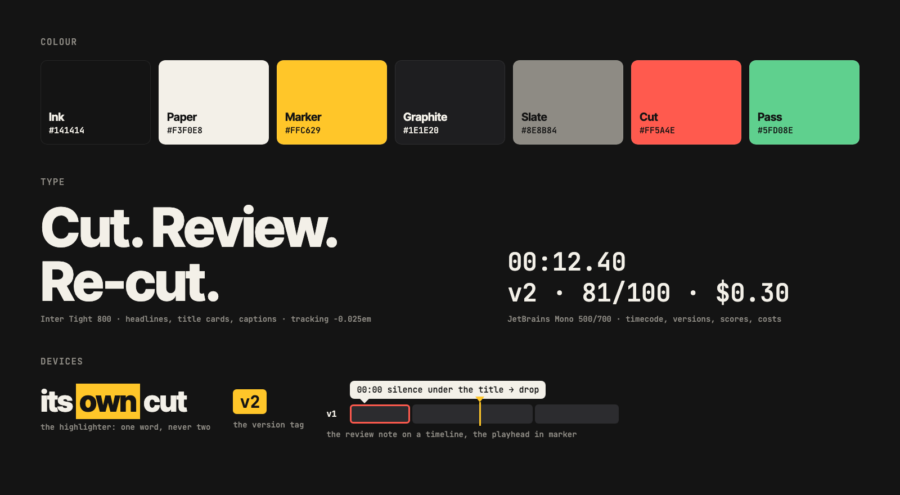

<p align="center">
  <picture>
    <source media="(prefers-color-scheme: dark)" srcset="svg/montivo-lockup-dark.svg">
    
  </picture>
</p>

# Montivo brand

Montivo is the video editor that watches its own cut. The identity says that in an editor's own marks: an in-point
and an out-point, a version between them, a highlighter on the word that matters, a note on a timeline. Made new for
the hackathon on 26 and 27/10/2026; nothing from the earlier project's logo carries over.



## The symbol

An in bracket and an out bracket with a marker-yellow V between them. Read fast it is an **M**; read slow it is
**[v]**, a version between an in and an out: the loop Montivo runs (v1, v2, v3) inside the mark. It is drawn on a
64 grid with 8-unit brackets, the same weight as the wordmark's stems at the lockup size, so it holds at 16 px.

The wordmark is lowercase **montivo** in Inter Tight 700, kerned by the font, tracked -0.02 em and outlined (no font
needed to use the files). In the lockup it sits on the brackets' bottom edge, 15 units right of the symbol.

| File | Use |
|---|---|
| `svg/montivo-lockup-dark.svg` | primary: on ink, dark UI, dark video |
| `svg/montivo-lockup-light.svg` | on paper and white, 32 px high and up |
| `svg/montivo-stacked-*.svg` | square and vertical spaces: end cards, avatars with room |
| `svg/montivo-symbol-*.svg` | where the name is already said, or there is no room |
| `svg/montivo-wordmark-*.svg` | running text headers, credits |
| `svg/*-mono-ink.svg`, `*-mono-paper.svg` | one colour: print, embossing, on busy photos |
| `svg/montivo-app-icon.svg`, `png/montivo-app-icon-*.png` | app icon: the mark on an ink tile |
| `svg/montivo-app-icon-marker.svg` | avatars and social profiles: ink mark on a marker tile |
| `svg/favicon.svg`, `png/favicon.ico`, `png/apple-touch-icon.png` | browser; the editor serves them from `web/public` |

**Clear space:** twice the bracket width on every side (16 units of the 64 grid; for a lockup 48 px high, about 15 px).
**Minimum size:** the symbol 16 px, the lockup 20 px high.

**Don't:** recolour the V in anything but marker (or the one colour of a mono version); put the yellow V on paper
under 32 px (use mono ink); stretch, rotate, outline or add a shadow; set the wordmark in another font or in capitals;
put the lockup on a busy frame without the mono version or a scrim; add a play triangle, a gradient or a glow.

## Colour

| Token | Hex | Use |
|---|---|---|
| Ink | `#141414` | backgrounds, type on paper |
| Paper | `#F3F0E8` | type on ink, light backgrounds |
| Marker | `#FFC629` | the one accent: the V, the primary action, the playhead, the version tag, a highlighted word. Never body text on paper |
| Graphite | `#1E1E20` | surfaces on ink |
| Slate | `#8E8B84` | secondary text, rules |
| Cut | `#FF5A4E` | errors and blocker issues only |
| Pass | `#5FD08E` | a review that passes |

Marker is used once per view. Nobody in the category owns yellow (Descript red, Submagic orange, VEED and Gling lime,
CapCut cyan, Opus and Runway black), and it stays clear of the violet "AI" gradient. The editor UI's tokens
(`web/src/styles.css`) and the render's caption highlight and callout colour (`montivo/engine/graphics.py`) read the
same values; `tokens.json` is the source.

## Type

- **Inter Tight** 700 and 800: the wordmark, headlines, title cards, burned-in captions (800, bundled in `montivo/fonts`).
- **Inter** 400 to 700: the editor UI and long text.
- **JetBrains Mono** 500 and 700: timecode (`00:12.40`), versions (`v2`), scores, dollars and logs. Numbers that came
  from a measurement are set in mono; that is the evidence voice.

All three are under the SIL Open Font License 1.1 (`fonts/OFL-*.txt`).

## Devices

- **The highlighter.** One word of a headline on a marker block with ink type, the way a reviewer marks a script:
  "The video editor that **watches** its own cut." One word, never two.
- **The version tag.** A marker chip with mono ink type, `v1`, `v2`. In motion it counts up; in the UI it marks the
  version on screen.
- **The review note.** A clip on a timeline with a red outline and a paper note at its timecode, and the fixed version
  under it with its score. Use real runs' numbers (run 015: v1 68, title card over 1.5 s of silence, dropped; v2 81, pass).
- **Crop marks.** Two corner marks frame a composition like a viewer.

## Voice

Say what it did, with the number. "Reviewed its own cut: 68, then 81." beats "10x faster AI editing". Short sentences,
editing words (cut, take, version, in, out, hook), no superlatives. The product line: **The video editor that watches
its own cut.** The loop line: **plan → render → review → re-cut.**

## Compositions and motion

| File | Size | Use |
|---|---|---|
| `png/montivo-social-preview.png` | 1280x640 | GitHub repo social preview (Settings, General, Social preview) |
| `png/montivo-thumbnail-1920x1080.png` | 1920x1080 | Cerebral Valley gallery thumbnail, demo video poster |
| `png/montivo-title-16x9.png`, `png/montivo-end-16x9.png` | 1920x1080 | the demo video's title and end cards |
| `png/montivo-title-9x16.png`, `png/montivo-end-9x16.png` | 1080x1920 | the X clip and reels |
| `sting/montivo-sting-16x9.mp4`, `sting/montivo-sting-9x16.mp4` | 2.4 s, 30 fps | logo sting: the brackets close in, the V drops and makes the M, a playhead sweeps the wordmark on, the tag counts v1 to v2 |

The title card that Muse Image draws for a rendered reel follows the same rules from its prompt
(`montivo/engine/image.py`): off-white heavy grotesk on flat ink, one word on a marker block, a marker light streak.

## Rebuilding

Everything above is generated, so a change to a colour or the geometry is one edit and one command:

```bash
python3 assets/brand/build.py --png
```

`build.py` needs `fonttools` and `uharfbuzz` (the SVGs), Pillow and a Chromium (the PNGs; it finds Playwright's headless
shell, or set `CHROME`). It also copies the favicon, touch icon and lockup into `web/public`; run `make web` after.
The sting is `node assets/brand/src/sting.mjs` (Playwright core and ffmpeg). Compositions live in
`src/compositions.html`, one frame per `#hash`; open the file without a hash to see them all.
